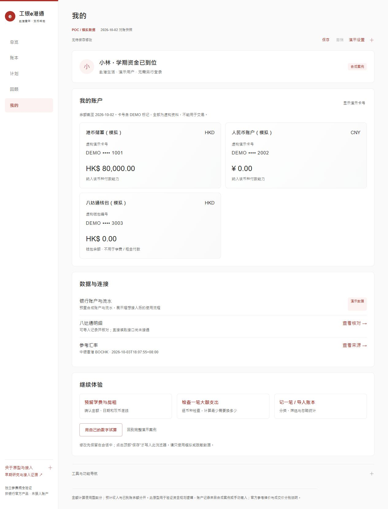

# 工银e港通

**赴港青年双币资金规划助手**

用途预留 · 逐币种逐日检查 · 最小换汇

面向赴港学生与初入职场青年的人民币 / 港币资金规划助手。把学费、房租和日常预算一起纳入付款能力检查，帮助用户判断：**这笔钱现在能不能花，需要换多少，能否按时付款。**

[产品导览](https://dual-currency-e-manager.onrender.com/) · [交互体验](https://dual-currency-e-manager.onrender.com/experience.html) · [阅读完整报告](../REPORT.md) · [五分钟演示](../docs/DEMO.md) · [开发与部署](../docs/DEVELOPMENT.md)

`v0.8.0` · `Node.js 24` · `无第三方运行依赖` · `136 项测试通过¹`

> 独立参赛原型，非银行官方产品。免登录体验；账户为合成案例或用户手动输入，银行及八达通真实接口尚未接通。

## 为什么做这个项目

账户总额并不等于某一天、某一种币种可以使用的钱。已到账的学费需要留到缴费日；港币余额也不能直接支付人民币商品。

本项目把三个步骤放在同一决策流程中：

1. **先保护用途**：为学费、房租及应急金设定预留。
2. **再检查时间与币种**：逐日核算港币和人民币，不提前计入预计收入。
3. **只换必要金额**：在不挪用另一币种预留的前提下，估算填补付款缺口所需的最小兑换额。

| 一笔购买的例子 | 结果 |
| --- | --- |
| 持有 CNY 10,000 与 HKD 20,000；需支付 CNY 12,000 | 人民币仍缺 2,000，不能只看折算后的总资产 |
| 按案例中有日期的 CNH 参考买入价 1.176990，额外费用为 0 | 估算需换出 HKD 2,353.98 |
| 同时需要保护 HKD 19,000 房租 | 可换资金不足，方案被阻止 |

报价是中银香港公开参考快照，不是工银亚洲可执行报价。费用、到账时间和跨境账户可达性需要另行确认。

## 两种体验方式

| 完整案例演示 | 手动试算 |
| --- | --- |
| 直接浏览账户、分类账本和付款计划 | 从空白账本开始填写双币余额及计划 |
| 展示银行数据接入后的目标体验 | 立即观察余额、预留和付款结果如何联动 |
| 适合快速评审或录制演示视频 | 适合评委亲自调整数字、检查边界 |

进入原型后，从“我的”查看账户与默认遮罩的虚构卡号；从总览选择“用自己的数字试算”。

<details>
<summary>查看用户中心界面</summary>



</details>

## 已实现的功能

| 模块 | 能力 |
| --- | --- |
| 总览 | 原币余额、可安排资金、下一笔付款及预留依据 |
| 账本 | 分类、筛选、预算、手动记账、CSV 导入和忽略统计 |
| 计划 | 学费 / 房租预留、重复事项、双币底线、逐日预测与情景检查 |
| 大额付款 | 双向最小换汇、买卖报价方向、费用与到账时间约束 |
| 回顾 | 可追溯规则摘要、预算偏差、维护进度与月报导出 |
| 我的 | 演示账户与卡号、余额、数据来源及手动试算入口 |
| 香港生活补充 | 八达通记录导入、充值 / 消费分离及余额核对 |
| 后续资金安排 | 在必要付款及流动性约束下检查存款期限容量 |

保存、撤销、备份与恢复均已提供。独立模式在浏览器内处理演示数据；嵌入模式使用宿主适配层，授权失败时不会回退到假账户。

## 本地运行

在克隆仓库的根目录执行，需 Node.js 24，无需安装第三方依赖：

```sh
node generate.cjs
node evidence.cjs
node --test tests/*.test.cjs
node server.cjs
```

打开 [localhost:4173](http://127.0.0.1:4173/)。生产部署使用仓库内的 [Render 配置](../render.yaml)，详见[开发与部署指南](../docs/DEVELOPMENT.md)。

## 文档导航

| 想了解什么 | 入口 |
| --- | --- |
| 完整项目方案、市场、技术、商业模式和验证 | [中文参赛报告](../REPORT.md) |
| 如何录屏或让评委亲自操作 | [演示指南](../docs/DEMO.md) |
| 代码分层、测试、配置、部署和报告导出 | [开发指南](../docs/DEVELOPMENT.md) |
| 银行 App / 官网如何嵌入 | [宿主模拟器](https://dual-currency-e-manager.onrender.com/host-demo.html) · [接口契约](../integration-guide.html) |
| 与工行已有功能的关系 | [官方资料对比](../icbc-comparison.html) |
| 完整功能入口 | [功能索引](../feature-map.html) |
| 早期说明与版本演进 | [原有 README（保留）](../README.md) · [v0.5 说明（保留）](../v05-notes.html) |

报告正文可直接阅读 Markdown；运行 `node export-report.cjs` 可生成图片、样式内嵌的离线 HTML，不依赖 Render 阅读。

## 当前边界

真实银行 / 八达通授权、实际换汇交易、正式投资适当性匹配以及 AI 月报均未接入。当前月报由确定性规则生成。用途红线用于规划预警，不冻结账户。

¹ 136 项测试为 v0.8.0 已验证结果，包括账本、双币规划、报价方向、宿主边界、手动试算和 HTTP 资源限制；它不代表生产认证或真实用户验证。另提供2,000组合成案例的独立枚举与约束消融实验，见[实验复现](../experiments/README.md)。
