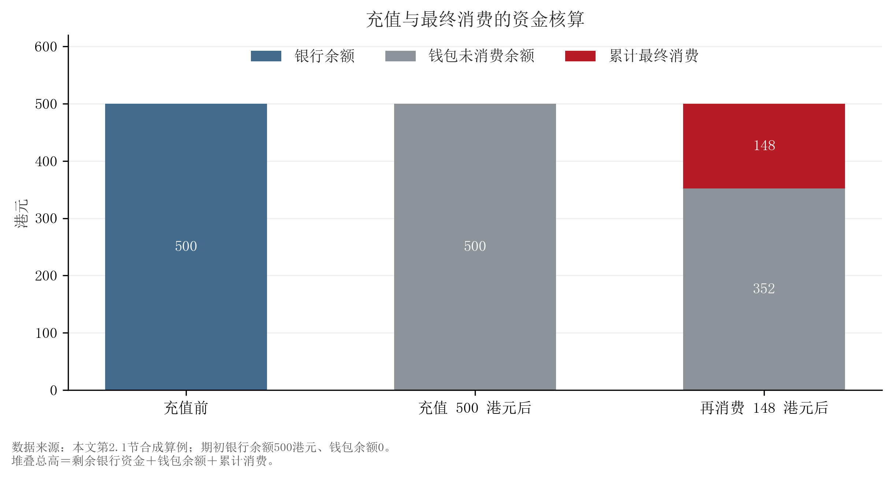
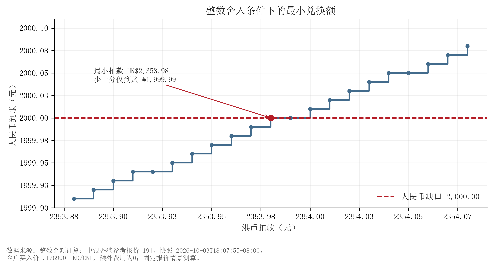
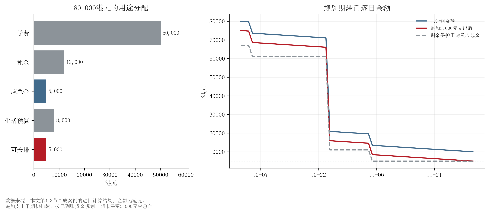
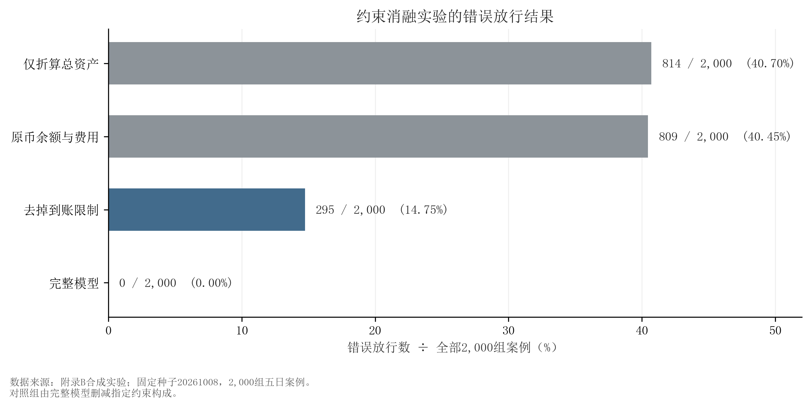
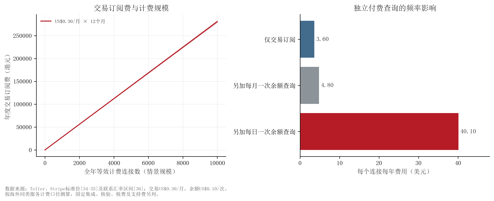
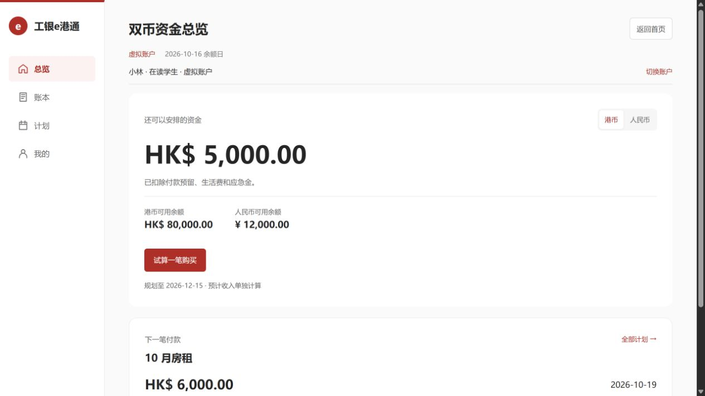
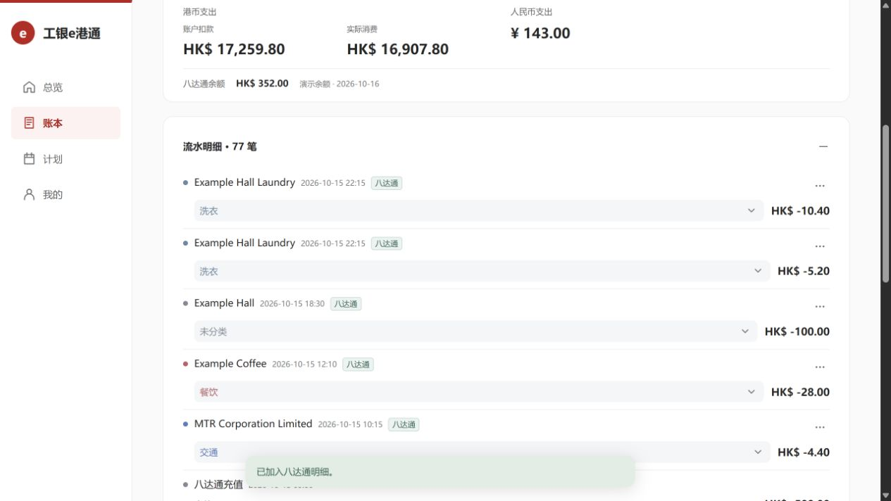
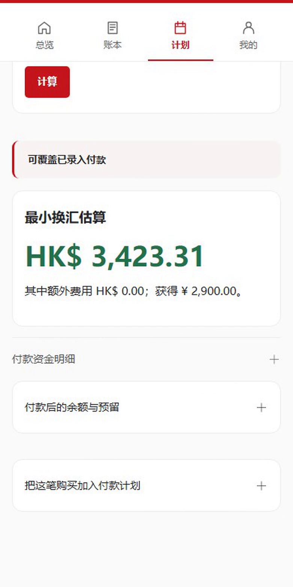
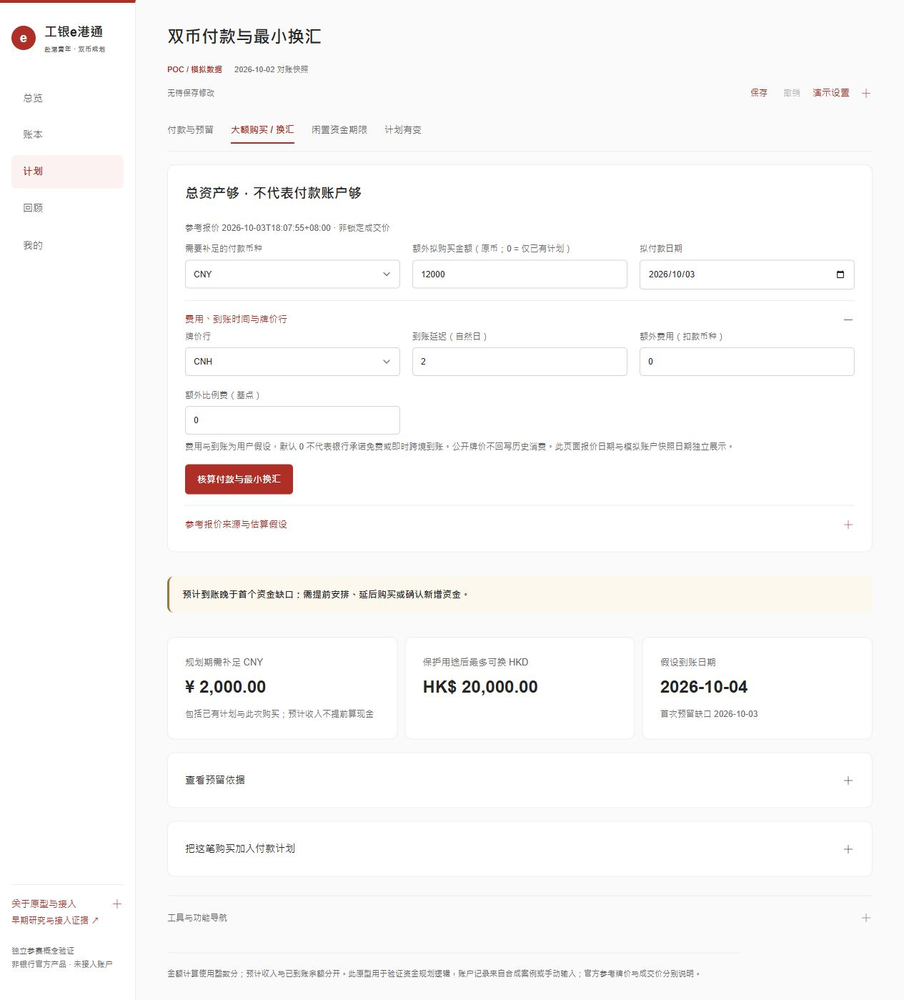

# 工银e港通

赴港青年双币资金管理助手

参赛赛道：____________________

参赛姓名：____________________

所在学校：____________________

<!-- TOC:START -->

## 目录

- [1　摘要](#section-1)
  - [1.1　原型与演示](#section-1-1)
- [2　问题界定与服务定位](#section-2)
  - [2.1　跨币种生活中的资金核算](#section-2-1)
  - [2.2　未来付款与资金可用性](#section-2-2)
  - [2.3　目标客群与服务范围](#section-2-3)
  - [2.4　工商银行既有能力与方案增量](#section-2-4)
- [3　产品设计与业务流程](#section-3)
  - [3.1　日常账本与预算管理](#section-3-1)
  - [3.2　用途预留与购买试算](#section-3-2)
  - [3.3　交互体验与持续管理](#section-3-3)
  - [3.4　自然语言规划与产品衔接](#section-3-4)
- [4　技术方法与可行性验证](#section-4)
  - [4.1　系统架构与账务一致性](#section-4-1)
  - [4.2　逐币种资金约束与最小换汇](#section-4-2)
  - [4.3　典型场景与计算结果](#section-4-3)
  - [4.4　独立验证与实验结论](#section-4-4)
  - [4.5　生成式交互与确定性工具调用](#section-4-5)
- [5　银行集成与八达通数据合作](#section-5)
  - [5.1　银行渠道集成与职责分工](#section-5-1)
  - [5.2　八达通企业合作的业务依据](#section-5-2)
  - [5.3　数据授权与账务整合](#section-5-3)
- [6　商业模式与实施路径](#section-6)
  - [6.1　服务价值与收益来源](#section-6-1)
  - [6.2　合作成本与经济性评价](#section-6-2)
  - [6.3　分阶段实施与运营评价](#section-6-3)
- [7　风险管理与服务扩展](#section-7)
  - [7.1　风险分类与模型治理](#section-7-1)
  - [7.2　操作安全与第三方管理](#section-7-2)
  - [7.3　客户权益与经营约束](#section-7-3)
  - [7.4　扩展功能的适用条件](#section-7-4)
- [8　结论](#section-8)
- [参考文献](#references)
- [附录A　流动性模型与求解方法](#appendix-A)
  - [A.1　决策域与基线现金流](#appendix-A-1)
  - [A.2　用途预留与币种约束](#appendix-A-2)
  - [A.3　费用函数与整数舍入](#appendix-A-3)
  - [A.4　求解算法与最小性证明](#appendix-A-4)
  - [A.5　模型假设与适用范围](#appendix-A-5)
- [附录B　实验设计与验证结果](#appendix-B)
  - [B.1　样本范围与独立枚举](#appendix-B-1)
  - [B.2　约束消融与适用范围](#appendix-B-2)
  - [B.3　计算性能与功能回归](#appendix-B-3)
- [附录C　合作成本与单位经济性测算](#appendix-C)
  - [C.1　八达通合作成本的公开披露](#appendix-C-1)
  - [C.2　可比数据服务及敏感性分析](#appendix-C-2)
  - [C.3　单位经济性与成本覆盖](#appendix-C-3)
- [附录D　原型运行与交互验证](#appendix-D)
  - [D.1　账户总览与用途预留](#appendix-D-1)
  - [D.2　分类账本与统计口径](#appendix-D-2)
  - [D.3　双币购买与最小换汇](#appendix-D-3)
  - [D.4　到账期限冲突](#appendix-D-4)

<!-- TOC:END -->

## 1　摘要

赴港学生及初入职场青年需要同时管理人民币、港币和八达通余额。学费、租金往往提前到账，日常开销却持续发生：银行余额中有多少已经另有用途，充值后还有多少留在钱包，下一笔人民币支出能否按时支付，单看收支分类或折算总资产难以回答。工银e港通将这些问题纳入同一资金计划。

方案以分类账本核对收支和资金转移，将学费、租金、生活预算及应急底线纳入逐币种、逐日检查。用户用文字或语音描述购买与付款需求，模型提取金额、币种和日期，追问缺失信息，并填入可编辑表单。购买参数齐全后，计算引擎检查未来付款和兑换到账条件，求出满足约束的最小兑换额。闲钱安排沿用这些约束，按可用期限、风险偏好及情景损失预算筛选产品。

新技术应用集中于生成式模型与资金计算工具的协作。模型通过受限函数调用整理需求，程序校验参数并执行整数金额计算，用户可以修改表单、复算结果。2,000组五日双币合成案例中，模型的可行性判断与最小兑换额均与独立逐分枚举一致；185项自动回归全部通过。线上原型已接入Qwen，10月17日录屏完整展示了缺失日期追问、自动填表、购买试算及修改金额后的重新计算。普通话、粤语和英语共用结构化输入接口。

银行落地方案复用账户授权、客户适用报价和交易复核，并预留机构模型适配层。拟由工银亚洲申请八达通企业数据合作，补充本地消费明细。银行可通过持续资金管理服务承接客户的缴费、兑换和资产配置需求，以增量资金贡献、交易净贡献及服务成本评价经营效果。

### 1.1　原型与演示

**在线原型：[打开工银e港通](https://dual-currency-e-manager.onrender.com/)**

首页分为“我的账本”和“演示账户”：前者从个人余额与计划开始，后者提供预设虚拟账户。页面提供学费与租金、双币购买、到账冲突及初入职场四种场景，并支持返回首页。

**普通话演示视频：【视频公开链接待填】**

视频二维码位置：【待视频上传后添加】

演示账户使用合成余额及交易，参考报价标注来源与时间。手机竖屏视频按实际操作展示分类账本、付款预留、闲钱安排和自然语言购买试算，时长约6分5秒。录屏保留输入、追问和重新计算过程；相关金额及报价条件见附录D。银行账户授权、八达通企业同步和交易复核方案见第5章。

## 2　问题界定与服务定位

### 2.1　跨币种生活中的资金核算

赴港青年的资金常经过人民币账户、港币账户和八达通，最后用于交通、餐饮等消费。换汇改变币种，充值改变资金载体，商户支付形成最终消费。银行流水记录本账户出入，个人账本则需要进一步追踪资金用途。

例如，期初钱包余额为零，用户充值500港元后消费148元，钱包尚余352元。在个人资金口径下，充值属于内部转移，最终消费为148元；同时计入两者会重复统计。未消费的352元保留为钱包资产，其能否用于学费或租金取决于实际支付或转出渠道。

消费统计按实际用途归集，付款规划则核验资金在指定日期、币种和渠道下能否使用。八达通明细用于识别充值后的消费去向，充值即时到账也需要这一步核算。人民币卡直接充值时，账本分别记录人民币扣款、港币入账及费用。

日常支付币种改变后，用户需要在港币标价、人民币预算和本地生活成本之间建立新的金额参照。已兑换的港币也可能被单独视为“在港生活资金”，影响原有预算的使用方式。

外币估值研究发现，名义金额会影响商品估值，汇率调整的充分程度受到经验与时间压力影响[1]。心理账户研究揭示了资金来源和用途分类对决策的作用[2]；支付形式研究则关注支付与消费之间联系的显著性[3]。这些研究为保留原币参照和用途分类提供了理论依据。

产品保留原币金额，显示分类预算及偏差，并在新增支出时检查未来必要付款。辅助折算标注汇率和日期，历史成本与当前估值分别呈现。

### 2.2　未来付款与资金可用性

学费和租金常提前到账，付款则发生在数周或数月后。当前余额因而同时承载日常开销与未来义务。若缺少日期和用途约束，同一笔资金容易被重复安排。

例如，用户持有人民币10,000元和港币20,000元，购买人民币12,000元商品仍有2,000元人民币缺口。能否动用港币补足，取决于港币已有用途、兑换费用及到账时间；月末工资也只有在到账后才能支持付款。折算总资产描述价值，逐日原币余额刻画支付条件。

本项目研究一笔新增支出在既定计划下是否可行，以及满足约束所需的最小换汇金额。用途预留是用户设定的计算与预警规则，银行账户支取权限仍由银行管理。

### 2.3　目标客群与服务范围

UGC《2025年资料册》列示，2024/25年度资助课程非本地学生超过26,600人[4]。目标用户为其中具有双币管理需求、能够通过银行渠道触达并自愿授权的群体。

校园阶段集中于学费、房租和生活费安排，毕业后延伸至租赁押金、首薪及两地资金管理。产品以这些资金任务界定客群，并通过银行现有校园及跨境服务渠道导入。

### 2.4　工商银行既有能力与方案增量

工商银行已有账户明细、收支分析和月度账单服务。工银灵通账户卡官方介绍列有明细查询及电子银行月度账单分析[5]；2026年4月系统维护公告列出收支分析、客户收支明细等服务[6]。2026年6月16日生效的融e行隐私政策进一步说明，用户可在收支明细备注中上传照片[7]。

从产品沿革看，工行“个人财务分析软件”已覆盖收支记账、资产负债、财务统计、预算、手工账户及计划提醒，并采用T+1联机数据和前一日汇率估值[8]。上述内容属于历史产品功能，现行手机银行按当前版本提供服务。

工银e港通在记账和预算基础上增加付款判断：关联充值与最终消费，将统计筛选与实际资金变动分开，结合必要付款、原币余额和到账日期计算可安排金额。第4章检验其计算模型。

工商银行已披露“工银智涌”金融大模型及应用开发平台，并推进“领航AI+”行动[9,10]。本方案将跨币种付款计算封装为受限工具，银行接入时可评估以工银智涌承接需求解析，复用既有字段校验和计算规则。

内地工商银行与工银亚洲分属不同服务渠道。工银亚洲e账通提供两地账户相关查询，工银财富账户及货币买卖提供香港渠道服务基础[11,12]。正式适配须分别确认账户授权、交易权限和跨境通道。

用途管理方面，工行智能资产配置涉及资金目标、期限与配置条件；工银亚洲智安存按其业务规则提供资金锁定[13,14]。本方案的用途预留用于规划计算，与实际冻结资金分别记录，使用户自主保留金额和银行可用余额共同参与判断。

表1　工商银行既有服务与本方案功能增量

| 既有服务基础 | 本方案补充的处理 | 可验证的结果 |
| --- | --- | --- |
| 账户明细与收支整理 | 关联银行转移、钱包充值及最终消费；保留原币与来源 | 充值本金不重复计入消费，缺失覆盖可识别 |
| 分类分析、用户备注及预算能力 | 将统计口径与真实现金流分离 | 忽略统计或更改类别不改变账户余额和付款约束 |
| 账户查询与资金目标管理 | 将学费、租金、生活预算及应急金纳入逐日原币路径 | 区分当前余额、用途预留及完整规划可安排额 |
| 货币买卖与交易复核 | 联合检查来源资金用途、目标币种缺口及可用日期 | 给出最小兑换额及少一分不足的验算，或说明不可行原因 |

约束消融和独立枚举结果见第4.4节及附录B。

## 3　产品设计与业务流程

### 3.1　日常账本与预算管理

账本记录日常收支、分类和内部转移；付款计划登记学费、租金、应急底线及日期。用户提出大额购买后，系统据此计算资金缺口、可换上限和最小兑换额。两项功能可分别使用，总览集中呈现可安排资金与近期付款，详细记录按需展开。

账务核对遵循“期末余额＝期初余额＋覆盖期内已记账交易净额”。用户筛选流水或排除某笔统计时，实际收支记录保持完整；退款与原消费采用一致的分析口径。

银行扣款与钱包充值匹配后，合并识别为一次内部转移；商户消费按用途分类。钱包余额能否用于某项付款，取决于支付渠道。转移未匹配和记录覆盖不全分别提示。

主方案以已到账资金为基础。预计工资和生活费进入条件情景，便于用户比较收入到账前后的付款能力。

### 3.2　用途预留与购买试算

规划页面分为“付款与预留”“购买与换汇”“闲钱安排”。付款与预留登记学费、房租、周期性付款和收入，并设置生活预算与应急底线；购买与换汇针对一笔新增支出，联合核验币种缺口、来源资金用途、费用及资金可用日；闲钱安排依据各期限内的最低资金余量，形成金额与期限备选。

付款试算在用户提交输入后显示结论。手动填写点击“计算”；自然语言草案经校验且信息完整后自动试算。用户修改金额、币种或日期时，旧结论立即隐藏，更新后的输入重新参与计算。必要付款的登记保留独立确认步骤，避免将一次试算直接写成付款义务。

结果呈现最小兑换额、目标币种到账金额及关键日期，资金明细和预留路径按需展开。出现来源资金不足或期限冲突时，页面指出相关约束，便于调整购买金额、付款日期或资金安排。正式交易由银行按客户适用报价完成复核。

### 3.3　交互体验与持续管理

首页提供功能说明及学生、双币购买、到账冲突、初入职场四类合成账户，用户可免登录修改数据、重置案例，或从空白账本开始。“返回首页”回到导览，数据保存在当前浏览器，访客之间相互独立。

界面设“总览、账本、计划、我的”四个入口。账本集中提供流水、分类预算和收支分析；用户中心展示模拟账户、遮罩卡号及数据来源。常用结果优先呈现，详细依据按需展开。附录D展示运行画面。

### 3.4　自然语言规划与产品衔接

文字与普通话、粤语、英语录音共用结构化输入流程。模型提取事项、金额、币种和日期，回填可编辑表单；缺失或歧义字段通过追问补全，用户也可直接更正。例如，“明天买一台人民币一万二千元的电脑”结合当前日期形成购买参数，校验通过后自动计算并定位结果。手动与智能输入使用同一资金引擎，相同参数对应相同结论。

产品衔接先确定各期限内可以暂不动用的金额，再结合风险偏好、产品类型、起投门槛和资金可用日筛选。普通定期存款依据工银亚洲公开条款[15]，适用利率按官方披露或开户查询结果呈现。投资候选采用演示目录检验风险与流动性筛选，银行落地时接入经审核的真实产品目录。

## 4　技术方法与可行性验证

### 4.1　系统架构与账务一致性

系统由账务、规划、求解和交互四个模块构成。账务模块校验记录并生成原币余额；规划模块组织逐日现金流与用途约束；求解模块计算可行性及最小兑换额；交互模块解释结果并支持计划修改。

外部账户与报价通过适配层输入。浏览器内的计算核心负责重算，服务器分发网页、获取公开参考报价，并使用服务端密钥请求模型。模型接收本次描述、余额日期和当前表单草案；草案可包含用户填写的余额、预算、金额及日期。完整流水、卡号和银行账户快照留在账务侧。这一划分允许银行分别替换数据接口与模型服务。

金额计算采用整数分和确定性规则，费用舍入、用途保护及日期约束均写入模型。月度消费事实由规则汇总。自然语言输入经字段校验后进入相同流程，模型解析和金额计算分别验证。

账户、交易、付款事项、规划参数和报价组成核心数据模型。金额以原币整数分参与运算[16,17]；输入按币种、日期、标识和金额范围校验。更正保留来源与版本，并触发计划重算。

### 4.2　逐币种资金约束与最小换汇

规划以已到账资金为起点，逐日扣除已登记付款与生活预算，并保留应急底线。对新增购买，系统计算来源币种可换上限H、目标币种期间最大缺口D及首个缺口日期。兑换金额须在H以内，且资金需在缺口发生前可用。

在固定买卖价、比例费用和固定费用条件下，扣款金额增加时，整数到账金额q(x)单调不减。系统通过二分搜索定位首个满足q(x)≥D的整数金额[18]，再验证两币种逐日余额；若q(x−1)＜D≤q(x)，即可确认以分为单位的最小性。完整定义、费用函数、求解步骤和适用条件见[附录A](#appendix-A)。

该模型把当前余额、未来用途和兑换时间纳入同一判断，适用于给定条件下的一次兑换。生产扩展需补充同币种账户可达性、营业日与报价生命周期。

### 4.3　典型场景与计算结果

合成账户基准日2026年10月2日，HKD20,000、CNY10,000；10月8日购买CNY12,000；暂不另设生活费、应急金与费用。采用已保存的中银香港CNH公开电汇参考快照，2026年10月3日18:07:55（香港时间），客户买入价1.176990、卖出价1.162840，单位HKD/CNH。本例采用固定离岸人民币参考价，实际交易使用银行适用报价[19]。

人民币缺口2,000元，港币最小扣款＝2,000×1.176990＝2,353.98元。逐分验算：扣235,398港分到账200,000人民币分；扣235,397港分仅到账199,999人民币分。兑换后港币17,646.02元，人民币12,000元；购买后人民币为0元，符合本例零底线。现实用户若设置应急金，系统需额外覆盖该底线。

表2　双币购买试算的约束与结果

| 场景 | 关键约束 | 结果与解释 |
| --- | --- | --- |
| A：没有额外港币用途 | H＝HKD20,000，D＝CNY2,000，即日可用 | 最少换HKD2,353.98；可行 |
| B：10月20日需付HKD19,000租金 | H降至HKD1,000 | 可换上限不足以补齐人民币缺口 |
| C：付款提前到10月4日，兑换3天后可用 | 10月5日到账晚于首个缺口日 | 期限冲突，需提前筹资或调整购买日 |

合成案例持有HKD80,000，安排学费50,000、两次租金合计12,000、应急金5,000和规划期生活预算8,000。用途红线为67,000元；进一步考虑生活预算，可新增安排5,000元。

图3比较原计划与期初追加5,000元支出的余额路径。必要付款发生时，相应预留释放；追加支出后的期末余额仍保留5,000元应急金。余额、用途红线和可安排额由此分别表达资金规模、已保护用途及完整规划下的剩余容量。

### 4.4　独立验证与实验结论

采用2,000组五日双币合成案例，将求解器与独立逐分枚举程序比较。案例覆盖双向购买、用途保护、费用与到账延迟，包括421组需换汇、682组无需换汇和897组不可行情况；可行性判断及最小金额全部一致。

约束消融显示，仅按总资产判断时有814组错误放行；加入当前原币余额和费用后为809组；保留未来付款但去除到账限制后为295组。完整模型在本次合成分布下与枚举基准一致，说明用途和日期约束对付款判断具有实际作用。

185项自动回归覆盖日期、预留、兑换、钱包、导入及宿主边界。实验输入、独立校验方法、性能条件及适用范围见[附录B](#appendix-B)。

### 4.5　生成式交互与确定性工具调用

生成式交互采用“意图解析—结构校验—信息补全—工具计算—结果回填”的工作流。Qwen通过Function Calling生成结构化草案[20]；Qwen语音识别将普通话、粤语和英语录音转写后送入相同流程[21]。输入日期以当前余额日为基准，金额按精度与范围检查，币种和事项类型受字段枚举约束。缺失项保持为空，补充对话携带已有草案，使用户可以逐步完善计划。

模型负责把生活语言转换为业务参数，确定性工具负责形成金额结论。购买草案完整时自动试算；新增付款、收入或账户设置通过对应表单确认后写入。模型请求只携带本次描述与所需表单上下文，账户完整流水和卡号由账务模块管理。请求期间用户修改字段或切换场景时，过期响应失效，避免覆盖新输入。

2026年10月17日的线上录屏中，用户先输入“我想买一台人民币12000元的电脑”。模型识别金额与币种后追问付款日期；用户补充“明天付款”，系统将日期填为10月18日并自动试算。随后将金额改为15,000元，旧结果隐藏，重新计算后显示新的换汇金额；再改为50,000元，系统提示可换余额不足。两次模型请求均返回成功，页面结果与独立金额复算一致，见附录D。

验证分开检查金额计算、接口行为和语言理解。185项回归中的固定响应测试检查非法字段、工具权限、追问上下文和异常处理；线上录屏检查真实模型请求与页面联动。三种语言的接口共用字段契约，识别质量则应以各自独立语料统计字段准确率、缺失项追问率和响应时延。本次手机录屏验证了普通话文字流程。

用户可以在自然语言和手动表单之间切换，金额结论始终由同一计算引擎生成。机构模型适配以字段契约、工具权限及审计要求为验收依据。

## 5　银行集成与八达通数据合作

### 5.1　银行渠道集成与职责分工

独立网页与模拟银行嵌入页面复用计算核心，银行依赖集中于数据和交易适配层。银行提供授权账户快照、客户适用报价和计划存储；模块返回规划结果及交易复核意图，银行完成强认证、限额检查、确认和执行。

账户快照包含可用余额、冻结金额和来源时间；报价包含方向、费用、有效期、通道与资金可用日。每次决策关联账户、计划和报价版本，交易复核时重新检查，状态变化即重算，执行结果以银行回执入账。

工银亚洲公开API平台提供合作申请线索[22]。方案优先在银行自有渠道试点，生产接入须完成账户映射、鉴权、跨境通道、营业日及安全联调。

### 5.2　八达通企业合作的业务依据

八达通明细能补充银行充值后的消费去向。用户提供的可见记录包含商户、时间、金额及充值条目，企业接入的关键在于取得约定范围的数据权利。

MTR Mobile允许用户输入八达通资料、通过车站数码服务站或八达通App关联卡片；其个人资料收集声明涵盖识别号码及港铁乘车系统中的相关历史和当前交易。该案例提供卡片关联与限定用途数据利用的业务先例，覆盖范围为港铁自身乘车记录[23]。

九巴club1933与The Point的推广条款还约定，经会员同意传送会员资料及指定路线乘车交易，体现跨机构、按目的共享记录的合作机制[24]。

拟由工银亚洲向八达通申请企业数据合作，协商消费明细范围、授权方式和同步责任。港铁案例支持卡片关联及特定用途的数据合作路径；全商户明细覆盖、更新频率和费用由双方合同确定。

### 5.3　数据授权与账务整合

拟由银行承担对客服务与数据使用责任，八达通提供约定记录。用户选择卡片并确认用途和范围，数据方完成关联校验，银行保存授权状态并控制读取权限。规划所需字段包括卡片代号、交易标识、原币金额、时间、商户描述、交易性质和覆盖区间；同步可按合同采用批量文件或增量接口。

卡片识别与客户认证分别处理，银行管理授权有效期、撤回及争议受理。原型已支持主动录入和标准化文件导入，合作同步可复用同一账务模型。界面按实际来源标明覆盖范围和更新时间。

每批记录保留来源、覆盖日期、导入时间及交易标识，充值出入账在匹配后关联为内部转移。期初余额或日期覆盖缺失时，显示已观察消费和待核对范围。

来源交易标识是去重的主要依据；相同商户、时间与金额的多条记录交由用户核对。退款关联原消费，补录、卡片更换及更正保留版本。撤回授权后停止新增同步，既有资料按适用保存要求处理。完整性评价综合覆盖、来源和余额核对结果。

## 6　商业模式与实施路径

### 6.1　服务价值与收益来源

工银e港通拟作为银行内嵌服务提供基础账务和规划功能。经营收益来自客户资金留存、交易渠道承接及自助服务带来的成本节省；身份认证、账户数据、报价和交易执行复用银行体系，集成与运营费用计入项目成本。

外部供应商可按实施费加年度维护费交付。银行评价项目收益时，同时计入供应商费用及渠道、客服等内部资源投入。

星展2025年年报披露，使用个性化提示的客户相较未使用者，储蓄为2倍、投资为5倍、保险保障为3倍[25]。这一关联为规划服务的商业逻辑提供参照，本项目据此建立资金留存与服务活跃度的观察框架，并在银行试点中按可比客群估计增量贡献。

学费与租金按实际持有天数折算增量年均余额，再按币种、期限及内部资金定价核定资金贡献[26]。交易收益按实际兑换量与渠道承接计量；自助服务节省扣除导入纠错和异常处理成本。由此可比较服务带来的净收益与持续投入。

### 6.2　合作成本与经济性评价

八达通合作采用企业合同核定数据范围、计费单位及服务责任。现有港铁披露能确认机构服务费用，但消费者明细接口的适用单价仍属合同参数。

以海外授权账户交易订阅的公开标准价为功能参照，单连接连续订阅12个月约为US$3.60，按联系汇率制度区间换算为HK$27.90—28.26。该数值用于测算数据成本量级；固定集成、余额查询及运营另列。资料来源、计费差异与查询频率敏感性见[附录C](#appendix-C)。

银行以增量资金贡献、交易贡献变化及服务净节省，扣除数据、运营、获客和风险成本评价单位经济性。年度净贡献进一步扣除初始投入及固定费用。收益归因采用一致人群与时间窗口，固定投入和实际经营参数由银行核定，计算式及成本覆盖条件见[附录C](#appendix-C)。

### 6.3　分阶段实施与运营评价

首期通过银行开户、跨境账户及校园渠道，围绕开学缴费、租约和生活费导入账务与付款试算。银行负责渠道及客服，产品团队负责计算与交互，数据和安全部门管理接入。试点先提供账户核对与规划，通过通道、状态管理和安全验收后接入交易复核；八达通同步按合同范围启用。

运行稳定后向初入职场青年扩展，增加工资日、租赁押金和两地资金安排模板，共用账务与约束核心。提醒由计划触发，权益计入运营预算。外部同步按卡片及合同权限开放，规划功能保持独立可用。

运营跟踪启用、账务核对、有效付款计划及持续更新。计划更新和预算纠错衡量使用质量；增量日均余额、交易净贡献及单位服务成本衡量经营表现；异常、投诉和撤权反映服务负担。银行据此调整推广规模和付费数据接入范围。

## 7　风险管理与服务扩展

### 7.1　风险分类与模型治理

参考巴塞尔委员会操作风险与第三方风险原则[27,28]，本项目按主要失效来源分为模型风险、操作风险、合规与行为风险、商业与战略风险。数据、信息科技和供应商依赖纳入操作风险，主责任按首要失效原因确定。

数据缺失导致错误余额，由数据运营负责核对；公式错误由模型治理处理；将规划结果宣传为付款保证，则由对客披露与行为风险管理控制。潜在损害、影响范围、可检测性及恢复难度共同决定处置优先级，金额错误、越权访问和重复交易隐患须阻断相关操作。

模型风险包括生成式模型的字段误解、遗漏与指令越界，以及计算模型的约束错误、实现缺陷和超范围使用。前者通过结构化输出、缺失追问、可编辑表单、写入确认和最小工具权限控制；后者通过独立枚举、金额边界和逐日约束测试控制。当前结论依赖固定报价、规定费用、单次兑换及已知到账条件；阶梯费率、账户通道与日内截止时间变化都可能改变可行域。

业务部门负责规则定义，模型维护方负责实现和变更，独立验证负责检验假设与结果。整数运算、边界回归和逐分枚举构成现有控制；生产扩展须补充对应测试。未登记义务和未来状态变化仍是剩余风险，结果与确认后的输入版本绑定。

### 7.2　操作安全与第三方管理

**数据质量。** 漏项、重复、退款错配和充值混计通过余额影响规划。来源标识、覆盖检查、导入预览和对账控制此类风险。余额待核对时限制付款判断，类别待确认时保留金额事实。数据责任人维护映射，运营人员处理争议并保留更正版本。

**运行与执行。** 余额、计划或报价变化使旧结果失效。银行在复核前刷新状态，以执行回执确认入账；结果未知的请求先查询状态，再决定后续操作。交易系统负责唯一请求标识、幂等控制和回执核对，服务故障时暂停受影响的执行衔接。

**信息安全。** 访问控制、会话管理、传输与存储保护、敏感日志管理共同降低资金及生活轨迹泄露风险。原型对模型请求执行来源检查、输入大小、并发及频次限制，密钥由服务端环境变量持有。录音和文本按最小必要范围处理，生产部署由银行核定数据地域、留存、模型供应商及ASVS验证要求[29]。

**第三方依赖。** 合作合同明确数据权利、服务范围、持续监督、价格变更及退出安排[28]。银行承担管理责任，同步异常时标明最后覆盖时间，并保留主动导入作为替代入口。

### 7.3　客户权益与经营约束

合规与数据治理负责确认处理目的、授权范围、保存要求及撤回机制。规划读取与营销授权分别管理，用户选择卡片及服务范围后，数据访问按授权状态执行。

对客解释清楚区分规划预留与银行冻结，说明计算条件、关键日期及报价时间。产品衔接须满足期限匹配与适当性要求，必要付款以已确认资金为基础。权益围绕记录核对和计划维护配置；辅助文本须核对金额、来源和交易状态。

经营风险包括短期使用、学费集中流出、兑换收入下降及持续数据成本。业务负责人依据有效使用、单位服务成本和可归因贡献评价项目，采购与财务控制合同总成本。

扩展规模以客户价值及经营承受能力为依据。数据同步成本偏高时，可调整覆盖或更新频率，保留主动导入；与开户、工资及缴费流程结合，有助于降低独立获客投入。

数据端监测对账差异与覆盖缺口，模型端监测结果偏差及适用范围，技术端监测报价失效、未知执行状态和越权请求，服务端跟踪解释错误及纠纷。阈值按业务重要性和服务水平设定。

事件处置依次限制受影响能力、核对事实、纠正记录及验证恢复。金额或权限异常隔离相关入口，辅助分类异常采取局部降级。版本记录、独立测试和恢复证据用于评价控制有效性。

### 7.4　扩展功能的适用条件

期限容量分析计算满足必要付款、生活预算及应急底线后，各币种在指定期限内可暂不动用的金额。存款候选按公开条款检查金额门槛及可用日期；投资候选进一步结合偏好等级、情景损失预算及赎回条件。用户提高风险偏好时，已有付款保护保持不变。

原型使用演示投资目录检验筛选逻辑，期限、起投额和压力损失参数均明确标为情景假设。资金锁定期内检查全额占用，赎回可用后检查压力损失对剩余付款的影响。实际产品须由银行接入经审核的目录、风险评级和费用条款，并完成客户适当性评估[30]。情景损失用于预算压力检验，实际市场损失可能超出设定幅度。

自然语言规划负责把需求转成可确认的字段，规则月报负责汇总消费事实、预算偏差和数据覆盖。后续解释服务可引用计算结果与来源，使生成文本能够逐项追溯。评价指标包括字段准确率、追问有效性、解释一致性和单次服务成本。

维护任务鼓励用户核对记录、更新计划和检查覆盖。银行权益围绕这些管理行为配置，运营关注计划更新、数据错误和服务留存。生产扩展同步完善账户可达性、营业日及报价生命周期，多币种和多次兑换则扩展决策变量及相应验证范围。

## 8　结论

工银e港通将分类收支转化为具体的付款安排：账本核清资金流向，逐日原币检查保护已登记用途，最小换汇计算补足目标币种缺口。用户可以直接输入需求，也可以逐项填表，修改金额后获得可复算的新结果。

在固定报价、规定费用和单次兑换条件下，2,000组合成案例与独立枚举全部一致，185项自动回归通过。线上录屏进一步展示了真实模型追问、表单回填与重新计算的全过程。闲钱安排复用付款保护条件，客户因此可以在同一计划下权衡消费、换汇及产品期限。

银行落地复用账户授权、适用报价和交易复核，并通过企业合作补充八达通消费明细。项目以可核验的资金安排服务赴港青年，经营评价采用可归因的资金贡献、交易净贡献和服务成本。

## 参考文献

[1] RAGHUBIR P, SRIVASTAVA J. Effect of face value on product valuation in foreign currencies[J]. Journal of Consumer Research, 2002, 29(3): 335-347. DOI: 10.1086/344430.

[2] THALER R H. Mental accounting matters[J]. Journal of Behavioral Decision Making, 1999, 12(3): 183-206. DOI: 10.1002/(SICI)1099-0771(199909)12:3<183::AID-BDM318>3.0.CO;2-F.

[3] RAGHUBIR P, SRIVASTAVA J. Monopoly money: the effect of payment coupling and form on spending behavior[J]. Journal of Experimental Psychology: Applied, 2008, 14(3): 213-225. DOI: 10.1037/1076-898X.14.3.213.

[4] 大学教育资助委员会. UGC pamphlet 2025[R/OL]. 香港: 大学教育资助委员会, 2025[2026-10-09]. <https://www.ugc.edu.hk/doc/eng/ugc/publication/pamphlets/UGC_Pamphlet_2025.pdf>.

[5] 中国工商银行. 工银灵通卡[EB/OL].[2026-10-09]. <https://www.icbc.com.cn/ICBC/个人金融/银行卡/标准借记卡/工银灵通卡.htm>.

[6] 中国工商银行. 系统维护公告[EB/OL].[2026-10-09]. <https://www.icbc.com.cn/page/1218498731646148608.html>.

[7] 中国工商银行. 中国工商银行融e行个人信息保护政策[EB/OL].[2026-10-09]. <https://m.icbc.com.cn/ICBC/disclaimer/2.htm>.

[8] 中国工商银行. 个人财务分析软件[EB/OL].[2026-10-09]. <https://m.icbc.com.cn/page/721853596277555221.html>.

[9] 中国工商银行. 工银智涌大模型应用平台[EB/OL].[2026-10-14]. <https://www.zj.icbc.com.cn/page/1111696122533318656.html>.

[10] 中国工商银行. 2026年一季度经营信息[EB/OL].[2026-10-14]. <https://www.icbc.com.cn/page/1223260226921385984.html>.

[11] 中国工商银行（亚洲）有限公司. e账通[EB/OL].[2026-10-09]. <https://www.icbcasia.com/hk/sc/promotion/mobile-banking-e-account-express-service.html>.

[12] 中国工商银行（亚洲）有限公司. 工银财富账户[EB/OL].[2026-10-09]. <https://www.icbcasia.com/hk/sc/personal/banking/integrated-account/wise-gold-account/default.html>.

[13] 中国工商银行. 智能资产配置[EB/OL].[2026-10-09]. <https://www.icbc.com.cn/column/1438058326864052368.html>.

[14] 中国工商银行（亚洲）有限公司. 智安存[EB/OL].[2026-10-09]. <https://www.icbcasia.com/hk/tc/personal/banking/deposits/money-safe/default.html>.

[15] 中国工商银行（亚洲）有限公司. Time deposit[EB/OL].[2026-10-17]. <https://www.icbcasia.com/hk/en/personal/banking/deposits/time-deposit/default.html>.

[16] Ecma International. ECMAScript language specification: the BigInt type[S/OL].[2026-10-09]. <https://tc39.es/ecma262/multipage/ecmascript-data-types-and-values.html#sec-ecmascript-language-types-bigint-type>.

[17] BRAY T. The JavaScript Object Notation (JSON) data interchange format: RFC 8259[S/OL]. 2017[2026-10-09]. <https://www.rfc-editor.org/rfc/rfc8259.txt>.

[18] National Institute of Standards and Technology. Dictionary of algorithms and data structures: binary search[EB/OL].[2026-10-09]. <https://xlinux.nist.gov/dads/HTML/binarySearch.html>.

[19] 中国银行（香港）有限公司. 外币兑换价[EB/OL].[2026-10-09]. <https://www.bochk.com/whk/rates/exchangeRatesHKD/exchangeRatesHKD-input.action?lang=en>.

[20] 阿里云. Function Calling[EB/OL].[2026-10-14]. <https://help.aliyun.com/zh/model-studio/qwen-function-calling>.

[21] 阿里云. Qwen-ASR API参考[EB/OL].[2026-10-14]. <https://help.aliyun.com/zh/model-studio/qwen-asr-api-reference>.

[22] 中国工商银行（亚洲）有限公司. 开放API开发者平台[EB/OL].[2026-10-09]. <https://www.icbcasia.com/hk/sc/personal/internet-banking/open-api-developer-portal/default.html>.

[23] 香港铁路有限公司. MTR Mobile terms and conditions and personal information collection statement[EB/OL].[2026-10-17]. <https://www.mtr.com.hk/en/customer/main/mtr-mobile-terms-and-conditions.html>.

[24] 九巴. club1933: terms and conditions and personal information collection statement[EB/OL].[2026-10-14]. <https://club1933.kmb.hk/en/register?token=1>.

[25] DBS Group Holdings. Annual report 2025: consumer banking/wealth management[R/OL]. Singapore: DBS Group Holdings, 2025[2026-10-17]. <https://www.dbs.com/annualreports/2025/consumer-banking-wealth-management.html>.

[26] GRANT J. Liquidity transfer pricing: a guide to better practice[R/OL]. Basel: Bank for International Settlements, 2011[2026-10-09]. <https://www.bis.org/fsi/fsipapers10.pdf>.

[27] Basel Committee on Banking Supervision. Revisions to the principles for the sound management of operational risk[R/OL]. Basel: Bank for International Settlements, 2021[2026-10-09]. <https://www.bis.org/bcbs/publ/d515.pdf>.

[28] Basel Committee on Banking Supervision. Principles for the sound management of third-party risk[R/OL]. Basel: Bank for International Settlements, 2025[2026-10-09]. <https://www.bis.org/bcbs/publ/d605.htm>.

[29] OWASP Foundation. Application security verification standard[S/OL].[2026-10-09]. <https://owasp.org/projects/asvs>.

[30] 香港证券及期货事务监察委员会. Compliance with suitability obligations[EB/OL].[2026-10-14]. <https://www.sfc.hk/en/faqs/intermediaries/supervision/Compliance-with-Suitability-Obligations/Compliance-with-Suitability-Obligations>.

[31] Node.js. Node.js v24 documentation: test runner[EB/OL].[2026-10-09]. <https://nodejs.org/docs/latest-v24.x/api/test.html>.

[32] 香港铁路有限公司. Interim report 2025[R/OL]. 香港: 香港铁路有限公司, 2025: 69[2026-10-14]. <https://www.mtr.com.hk/archive/corporate/en/investor/interim2025/E15.pdf>.

[33] 八达通卡有限公司. Become an Octopus merchant[EB/OL].[2026-10-14]. <https://www.octopus.com.hk/en/business/faq/octopus-for-businesses/become-octopus-merchant.html>.

[34] Teller. Teller: pricing[EB/OL].[2026-10-17]. <https://teller.io/>.

[35] Stripe. Pricing & fees: Financial Connections[EB/OL].[2026-10-17]. <https://stripe.com/pricing>.

[36] 香港金融管理局. Hong Kong’s linked exchange rate system[R/OL].[2026-10-09]. <https://www.hkma.gov.hk/media/eng/publication-and-research/reference-materials/monetary/HKMA_LERS_English_version.pdf>.

## 附录A　流动性模型与求解方法

### A.1　决策域与基线现金流

令币种集合为HKD、CNY；规划起点为0，天数为T（1—366）；金额均为整数分。B(c,0)为已到账且可动用余额，P(c,t)为第t日必要支出和拟新增购买，L(c,t)为当日生活预算，I(c,t)为收入。保守主方案对未来I取0；条件情景才使用预计收入。默认同日先付款后收入。

`b(c,t) = b(c,t−1) − P(c,t) − L(c,t)`

其中生活预算按累计比例分配并取整：第t日分配为`floor(Vc·t/T) − floor(Vc·(t−1)/T)`，保证整段分配恰好等于用户输入的Vc。b表示日内付款后的低点；未到账收入不会遮住这个低点。均匀分配是一项预算假设；已知大额事项单独登记，突发支出通过情景调整检查。

### A.2　用途预留与币种约束

设应急金为E(c)，手动底线为M(c)，未来受保护付款总额为P*(c,t)。界面展示的用途红线为：

`R(c,t) = max(E(c) + P*(c,t), M(c))`

用途预留在事项到期后释放；对应付款仅在现金流中扣减一次。逐日支付底线为`F(c)=max(E(c),M(c))`。生活预算已经逐日扣除，不再次并入F。模型同时约束当前可换出资金与未来各日的余额低点。

设来源币种为s、目标币种为d。新增购买已计入基线后：

`H = min(B(s,0) − R(s,0), min_t[b(s,t) − F(s)])`

`D = max(0, max_t[F(d) − b(d,t)])`

H是可换出上限；H小于0说明来源币种本身已不满足保护条件，求解拒绝。D是一次补足整个规划期所需的目标币种金额，未必只等于当前购买缺口。若D为0，无需换汇；否则找首个缺口日t*，要求兑换资金在t*付款前可用。规划外及起点当日事项须先调整覆盖范围，再进行求解。

### A.3　费用函数与整数舍入

参考表单位为“每1元人民币对应港币”。r买表示客户买人民币价格，r卖表示客户卖人民币价格。给定来源币种总扣款x、比例费率b基点和固定费用f：当x为0费用为0；否则`fee(x)=ceil(x·b/10000)+f`，`net(x)=max(0,x−fee(x))`。

`HKD→CNY：q(x)=floor(net(x)×1,000,000 / r买整数)`

`CNY→HKD：q(x)=floor(net(x)×r卖整数 / 1,000,000)`

费用假定从来源金额扣除，到账金额向下取整。如果银行实际费用从其他账户另扣、存在最低兑换单位或阶梯价格，须调整费用模型并重新验证最小性。

### A.4　求解算法与最小性证明

1. 校验状态、日期覆盖与数据口径，构造新增购买后的两条基线现金流。
2. 计算H、D和首个缺口日；来源已穿底线则拒绝，D为0则返回无需兑换。
3. 检查参考价是否存在、预计可用日是否早于或等于缺口日；晚到则拒绝。
4. 检查q(H)能否覆盖D；不能覆盖则返回可换上限及缺口原因。
5. 在整数区间[0,H]二分查找首个满足q(x)≥D的x；重算兑换后的两币种逐日低点。
6. 同时输出q(x)及q(x−1)、最低余额、报价时间和假设，供用户或审阅者复核。

在0≤b＜10,000、固定费和价格不变时，每增加一分扣款，向上取整的比例费用最多增加一分，因此net(x)不下降；乘除正价格并向下取整后q(x)仍不下降。满足q(x)≥D的金额构成区间。二分查找返回该区间左端点；若同时有`q(x−1)<D≤q(x)`且x≤H，就给出以分为单位的最小性证书。

源资金当日扣减x，目标资金从约定可用日增加q(x)，最后逐日检查两币种低点不小于F。二分搜索用于确定单调可行域的左端点[18]。

模型假设资金在可用日付款前可支用；银行接入需结合营业日和截止时间给出保守可用日。算例使用固定历史参考报价，执行前须按有效报价重新计算。

### A.5　模型假设与适用范围

当前模型按币种汇总可动用账户，以已到账资金支持一次兑换。结果适用于给定报价、费用、付款计划和到账条件；同币种跨行可达性、通道限额、多次兑换及营业日处理需在生产模型中补充。

## 附录B　实验设计与验证结果

测试采用合成数据，对照组由完整模型删减指定约束构成。

### B.1　样本范围与独立枚举

实验固定随机种子20261008，共2,000组五日双币案例。每币种期初60—240分；购买20—240分；应急金0—20分、手动底线0—30分、每币种生活预算0—20分；另有0—100分必要付款及一笔不计入主方案的预计收入。覆盖两种购买方向、保护开关、0/50/200基点比例费、0—3分固定费、0—6日延迟及1—5日付款。金额区间采用较小整数，以便穷举全部候选兑换额，验证边界与舍入行为。

校验程序独立重建现金流、计算整数到账并枚举每个扣款金额，不调用生产代码的预测、报价或红线函数。与求解器逐例比较接受/拒绝和最小扣款。两套实现共享业务定义，但不共享求解过程，用于降低同一实现错误同时影响计算与校验的可能性。

### B.2　约束消融与适用范围

表3　约束消融与独立枚举结果

| 方法 | 不可行却放行／2,000 | 可行却拒绝／2,000 | 比较范围 |
| --- | --- | --- | --- |
| 仅折算当前总资产 | 814（40.70%） | 0 | 忽略未来用途、费用和到账 |
| 当前原币余额＋兑换费用 | 809（40.45%） | 0 | 忽略未来付款、生活底线和延迟 |
| 保留用途及未来付款，去掉到账限制 | 295（14.75%） | 0 | 单独观察时间约束的贡献 |
| 完整模型对照独立枚举 | 0 | 0 | 421需换汇、682无需换汇、897不可行；最小额全部一致 |

对照组由完整模型删除指定条件构成，比例均以2,000组案例为分母。421组需换汇、682组无需换汇、897组不可行，最小金额全部一致。结论适用于本次五日合成分布，多账户通道、真实交易及长期大规模性能需单独验证。

### B.3　计算性能与功能回归

在Windows x64、Intel Core Ultra 9 285H、Node v24.19.0上，预热100次后计时2,000次求解；本次五日小案例P50为0.0764ms、P95为0.1504ms，计时范围为本机求解过程。2026年10月17日复核，185项基于Node.js内置测试运行器的自动回归全部通过[31]，覆盖日历、资金预留、双向兑换、钱包口径、导入、宿主、产品匹配和模型接口。其中9项产品匹配测试检验压力损失、跨币种缺口及预期收入隔离；15项模型与HTTP接口测试采用可控返回值，检验字段契约和故障处理。

## 附录C　合作成本与单位经济性测算

### C.1　八达通合作成本的公开披露

港铁2025年中期报告第69页披露，上半年向八达通集团支付或应付中央结算服务费用7,000万港元；另有1,500万港元为港铁提供代理、发卡退款、设备及仓储等服务而收取或应收的费用。两项分别对应结算采购与服务收入，提供了机构合作的财务证据[32]。

截至2026年10月14日，本次核查的八达通、MTR及club1933官方资料未披露适用于消费者历史明细的数据接口单价。商户受理费与交通结算费各有业务口径[33]，明细服务的固定接入费、最低合同额及企业支持费保留为待定合同参数。

### C.2　可比数据服务及敏感性分析

以授权账户交易数据服务作为功能相近的成本参照，Teller与Stripe官方交易订阅标准价均为US$0.30／月：Teller按enrollment计费，Stripe按机构及账户持有人计费[34,35]。统一假设每位用户对应一个计费连接、连续订阅12个月，则交易数据费为US$3.60／用户年。

按联系汇率制度7.75—7.85港元／美元的兑换保证区间[36]换算，为HK$27.90—28.26／用户年。每1,000个连接年对应HK$27,900—28,260。这是海外同类功能的预算参照，区间由汇率换算产生，八达通采购预算按实际合同核定。

两家平台另列余额查询US$0.10／次[34,35]：每月一次增加US$1.20／年，每日一次增加US$36.50／年。图5据此展示连接规模和查询频率的成本敏感性。预算宜将交易数据、余额核对、固定集成及运营分别列项，优先按业务所需字段和更新频率确定同步方案。

### C.3　单位经济性与成本覆盖

以一年为评价期，N为全年等效有效用户数，即有效用户月数之和除以12。每用户净贡献u由增量年均余额ΔB、净资金贡献率m、交易贡献变化ΔG、服务净节省S，扣除运营c、获客及权益a、预期损失l和数据成本d构成，金额统一为港币。

`u = ΔB·m + ΔG + S − c − a − l − d`

`首年项目净贡献 Π₁ = N·u − I − F`

I为首次集成及安全评估等投入，F为固定运营、许可及合同最低费用。数据成本按实际计费连接月数分摊；可抵扣的合同最低费按约定抵扣。首年全额扣除I采用现金投入比较口径。u＞0时，成本覆盖规模为`ceil((I+F)/u)`。

现有公开资料支持约28港元／连接年的交易数据成本参照，经营增量及固定投入则需银行数据核定。数据直连相较主动导入所增加的净贡献，需要同时覆盖数据费、固定接入分摊和新增运营。收益归因采用一致人群与时间窗口，结合可比客户或分阶段渠道结果，控制开学季、工资变化等因素。

## 附录D　原型运行与交互验证

以下画面截自实际运行原型，账户及流水为合成数据。10月17日手机录屏展示本附录的购买试算与金额修改流程；其他截图分别标注对应场景和日期。

### D.1　账户总览与用途预留

原型支持独立网页和模拟银行宿主两种运行方式。用户免登录选择合成案例，也可录入脱敏金额；用户中心展示模拟账户及遮罩卡号。

图6对应第4.3节：80,000港元余额与5,000港元可安排额分别呈现，必要付款与生活预算共同决定可安排资金，用户可展开预留依据。

### D.2　分类账本与统计口径

图7展示导入后的八达通来源标签及逐笔分类。用户可按日期、类别、币种及账户筛选，再调整分析口径。实际扣款保持完整，关联退款与原消费一致处理；八达通核对沿用同一核算规则。

### D.3　双币购买与最小换汇

图8对应2026年10月17日手机录屏。账户持有CNY10,000和HKD20,000，计划10月18日购买CNY12,000，并保留规划期内CNY900生活预算，目标币种因此需补足CNY2,900。按页面客户买入人民币参考价1.180450 HKD/CNH、额外费用0计算，最小港币扣款为HKD3,423.31：扣342,330港分到账289,999人民币分，扣342,331港分到账290,000人民币分。

将购买金额改为CNY15,000，目标币种缺口增至CNY5,900，按同一参考价计算需HKD6,964.66；改为CNY50,000后，可换余额不足。第4.3节的固定报价算例采用1.176990及零生活预算，用于复算基础算法；本节保留生活预算并采用录屏当日报价，两组结果的差异来自输入条件。

### D.4　到账期限冲突

图9将同一案例的到账延迟改为两个自然日：资金10月4日可用，晚于10月3日付款。系统提示期限冲突，供用户提前筹资或调整购买日期。该操作验证了到账时间对可行性的影响。

