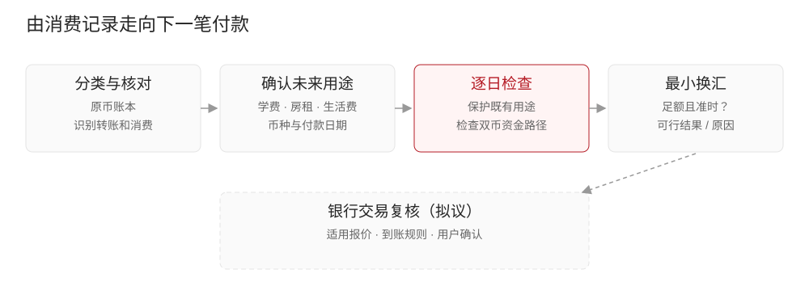
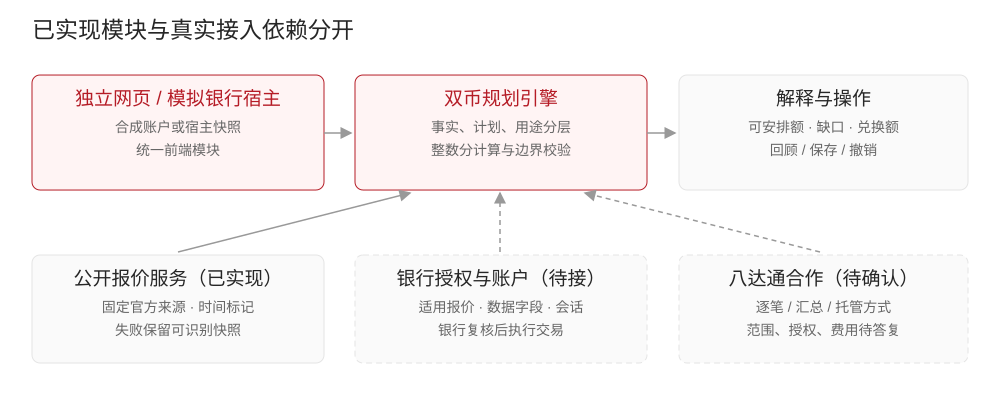
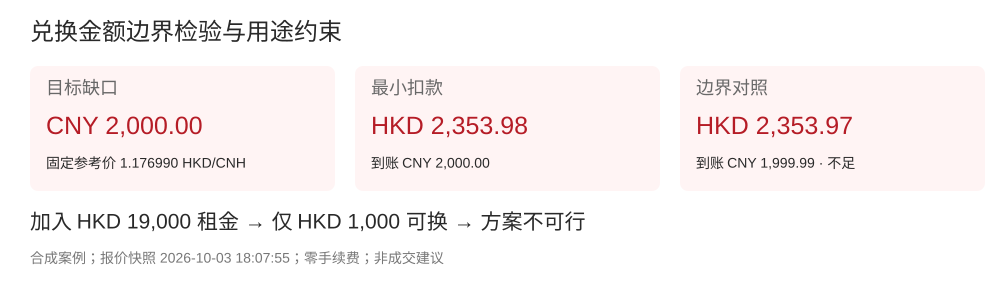
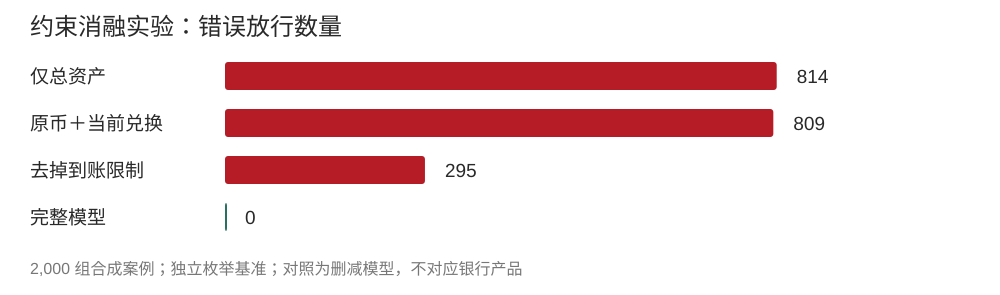
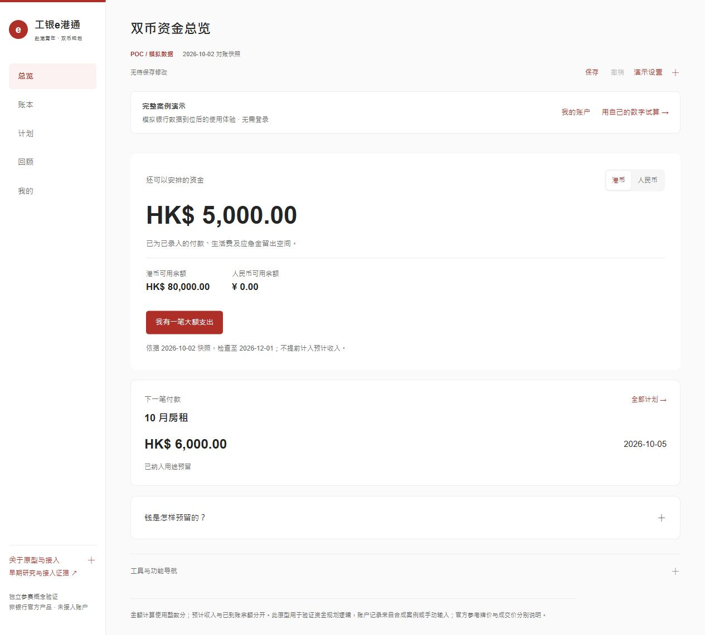

# 工银e港通

赴港青年双币资金规划助手

**用途预留约束下的人民币—港币流动性规划系统**

第十七届“工行杯”全国大学生金融科技创新大赛

参赛方向：青年群体服务

2026年10月9日　｜　技术实现：v0.8.0

本项目面向同时使用人民币与港币的赴港学生及初入职场青年，将未来付款义务、资金用途和兑换条件纳入统一模型，为大额支出安排提供逐币种、逐日的流动性分析。

正文依次讨论业务问题、产品方案、数据结构、约束模型、算法与实验、银行集成及实施路径。技术结论由文内算例和可复现实验支撑；在线原型用于展示操作过程和结果解释。

[在线原型](https://dual-currency-e-manager.onrender.com/) · [银行宿主集成演示](https://dual-currency-e-manager.onrender.com/host-demo.html)

本项目为独立参赛方案。涉及银行与八达通的生产接入，按文中所述合作条件实施。

## 1　摘要

跨币种个人资金管理需要同时考虑资产价值、付款币种和资金可用时间。对于在香港求学或开始工作的非本地青年，学费、租金等大额款项往往提前到账，其支付日期又与日常消费、生活费汇入或工资发放错开。账户余额因而包含不同用途和期限的资金，仅依据折算总资产或月度收支结余，难以判断一笔新增消费是否会影响后续必要付款。

工银e港通以人民币和港币为对象，将这一问题表述为有限规划期内、用途预留约束下的流动性规划。系统首先核对已到账资金与历史交易，再按日期展开必要付款和生活预算，分别计算两种币种的资金路径。在此基础上，针对一笔拟新增购买，确定来源币种的最大可换出金额、目标币种的最大资金缺口及兑换到账期限；在固定报价和费用条件下，求出满足全部约束的最小兑换额。若不存在可行解，系统返回限制条件及对应日期，供用户调整购买金额、付款日期或资金安排。

本项目的主要贡献在于将用途预留、逐日原币余额和兑换决策联动。预留规则限定已到账资金的可安排范围，现金流模型识别付款日前的短缺，整数金额求解保证费用与舍入规则下的兑换精度。分类账本、退款关联、统计排除和钱包对账为该模型提供一致的数据基础。八达通消费明细作为香港地区的数据补充，用于区分充值与最终消费，并改善分类结果的完整性。

系统已实现可独立运行的网页原型与模拟银行宿主适配层。技术验证包括136项自动回归测试，以及2,000组五日双币合成案例的独立逐分枚举对照。后者包含421组需换汇、682组无需换汇和897组不可行案例，求解器的可行性判断及最小金额均与枚举结果一致。约束消融进一步表明，在该实验分布下，忽略未来资金义务或兑换到账条件会产生错误放行。实验结论限于所定义的模型与输入范围，不涉及实际客户行为或银行经营收益的统计估计。

实施上，项目定位为银行现有账户与跨境服务中的规划模块。银行负责身份认证、授权数据、可执行报价及交易复核，规划模块负责资金约束计算和结果解释。首期采用手动输入、标准化文件导入和模拟宿主验证业务流程；生产接入重点补充账户可达性、营业日、报价有效期和交易回执机制。项目由此形成从资金核算、付款分析到交易前复核的连续流程，为跨境青年资金管理提供具有明确计算依据的辅助工具。

## 2　业务背景与问题界定

### 2.1 跨币种资金管理的约束特征

人民币与港币的并存使个人资金管理包含两类不同问题。其一是价值计量，即把不同币种资产折算为统一口径；其二是流动性安排，即在给定付款日期将资金置于能够完成支付的币种和账户。两者不能相互替代。折算资产充足时，仍可能由于原币余额不足、来源资金已被其他用途占用，或兑换到账晚于付款，导致支付安排不可行。

学费和租金使这种差异更加明显。预先汇入的学费在账户中仍表现为可用余额，但其经济用途已确定。若规划时没有保留该义务，新增消费会与未来付款竞争同一笔资金。毕业初入职场阶段则常出现押金、首期租金早于首薪的情况，月末收入能够覆盖支出，也不意味着月中具有足够支付能力。因此，本项目关注已到账资金如何在不同币种、用途和日期之间分配。

### 2.2 服务对象与典型任务

项目优先服务存在人民币与港币收支、在香港生活的非本地青年，包括学生及初入职场者。用户范围以资金需求界定：具有日期明确的必要付款，同时需要安排日常预算或另一币种的大额消费。其他货币、企业资金池及复杂投资组合不属于当前模型的处理范围。

| 任务场景 | 主要约束 | 系统输出 |
| --- | --- | --- |
| 学费提前到账 | 已到账余额具有既定用途 | 扣除必要付款、应急金及生活预算后的可安排金额 |
| 人民币大额购买 | 人民币不足，港币资金可能已预留 | 最小兑换额及兑换后两币种的余额低点 |
| 租房与首薪错位 | 必要支出早于预计收入 | 首个缺口日期、金额及条件情景 |
| 八达通日常消费 | 银行充值与钱包内消费分属不同记录 | 资金转移、最终消费及数据覆盖范围 |
| 短期资金安排 | 资金用途与存款可支用日存在期限关系 | 给定期限内的可安排资金上限 |

### 2.3 研究范围

方案的问题定义结合跨境生活场景、公开银行服务资料和八达通记录的字段观察。本阶段采用业务场景分析、数学建模、原型实现和软件实验，研究约束是否完整、计算是否一致、结果能否被复核。用户输入中的必要付款与预算构成模型条件；系统不对未登记义务作自动推断，也不预测未来汇率或投资收益。

在这一范围内，一次规划的有效输出应包括判断结果及其依据：哪些资金已预留、缺口发生在哪一天、最低兑换额如何得到，以及哪些输入变化会使原方案失效。对不可行方案提供明确原因，是资金规划功能的一部分。

## 3　市场定位与竞争分析

### 3.1 目标市场与进入路径

UGC《2025年资料册》列示2024/25年度资助课程非本地学生超过26,600人。该统计覆盖资助课程中的非本地学生，包含不同来源地和币种需求，且不包含本方案全部毕业生群体。其规模可作为识别校园服务场景的背景依据，具体可触达范围仍取决于双币需求和渠道覆盖。[UGC资料册](https://www.ugc.edu.hk/doc/eng/ugc/publication/pamphlets/UGC_Pamphlet_2025.pdf)

进入市场的单位应是“一个校园或青年服务渠道中的双币付款任务”。拟议试点从单一校园的学费/租金场景开始，再扩展到毕业首薪过渡期。可服务人数应按可触达人数、双币需求比例、自愿授权比例和完成规划比例逐层记录。这一分层口径用于区分人口规模与实际服务范围，并为后续渠道规划提供统计基础。

### 3.2 既有能力与项目增量

| 能力 | 已有公开依据与重叠 | 本项目增加的判断 |
| --- | --- | --- |
| 流水、收支分类、筛选 | 银行账单和收支分析已经存在；用户亦观察到中银分类及排除 | 分类结果进入预算，但排除统计不删除真实现金流 |
| 两地账户查看 | 工银亚洲e账通可提供内地账户相关查询服务 | 在已授权数据上加入未来义务，按付款币种重算可用金额 |
| 教育金、大额资金规划 | 工行智能资产配置已有目标、期限、现金流与风险匹配 | 收窄为近期确定付款与一次临时购买的可支付性 |
| 资金保护 | 工银亚洲智安存提供真实资金锁定机制 | 日期驱动的用途预留与软预警，目的及权限不同 |
| 货币买卖 | 银行已有换汇及交易复核 | 先判断是否需要换、最多能换、最少换多少、是否来得及 |

来源：[工银财富账户](https://www.icbcasia.com/hk/sc/personal/banking/integrated-account/wise-gold-account/default.html)、[智能资产配置](https://www.icbc.com.cn/column/1438058326864052368.html)、[智安存](https://www.icbcasia.com/hk/tc/personal/banking/deposits/money-safe/default.html)、[e账通流程](https://www.icbcasia.com/hk/sc/promotion/mobile-banking-e-account-express-service.html)。该比较基于公开服务说明，具体功能覆盖及渠道版本以银行实际系统为准。

### 3.3 差异化及实施基础

项目的差异化集中在近期、确定性付款的联动分析：用途约束决定可安排资金，日期约束识别期间缺口，币种与报价条件决定所需兑换。其实施基础是可复用的数据结构、明确的银行适配接口和可重放的计算规则。与现有账户及交易服务协同，可以减少用户在不同功能之间自行汇总和核算的步骤。

## 4　产品方案与业务流程

### 4.1 资金规划流程



用户先选择演示案例或输入自己的脱敏数字，核对两个币种余额；再登记学费、房租、应急底线和生活预算；最后输入拟购买金额与日期。首页仅突出可安排资金、最近必要付款和需处理事项。详细账目、推导依据、条件情景与产品初筛在对应入口展开，避免首页堆放所有能力。

### 4.2 功能结构

| 层次 | 当前原型中的功能 | 与主线的关系 |
| --- | --- | --- |
| 数据准备 | 分类、组合筛选、统计排除、退款、CSV、手动记录 | 把历史支出和当前余额核对清楚 |
| 必要付款 | 双币用途预留、手动底线、生活预算、重复付款日历 | 确认哪些资金不能再次安排 |
| 购买决策 | 双向最小换汇、费用与延迟、逐日检查、保存购买计划 | 把一次消费放回全部义务中判断 |
| 持续维护 | 月度规则回顾、预算偏差、撤销、保存和备份 | 让输入随生活变化而更新 |
| 用户中心 | 模拟账户及遮罩卡号、数据模式、手动起步 | 区分示例与用户输入，不要求演示登录 |
| 扩展辅助 | 八达通导入核对、期限容量、模拟宿主 | 补足本地消费与未来机构落地 |

### 4.3 结果解释与计划调整

可行时显示“需补人民币2,000元，参考需换出港币2,353.98元”，并展开报价时间、费用和保护条件。不可行时指出限制来自来源币种租金、到账晚于付款或数据覆盖不足，再引导改日期、改金额或确认新增到账。预计收入与已到账资金分别显示；解除保护由用户明确修改计划后重新计算。规划结果进入银行复核流程后，适用报价、余额和交易条件仍需再次确认。

## 5　系统架构与模块划分



### 5.1 分层职责

账务层负责交易校验、对账与资金口径；规划层建立逐日现金流和用途约束；求解层只在给定状态及报价下返回结果；展示层提供解释、修改与确认。独立Node服务承担静态分发、健康检查和公开牌价代理，模拟宿主通过适配器提供账户快照。核心计算不依赖远端模型服务，适合在浏览器内快速重算和离线重放。

| 模块 | 输入与输出 | 当前实现位置 |
| --- | --- | --- |
| 账务与预测 | 账户、流水、计划 → 原币余额、逐日低点、数据警告 | `engine.js` |
| 预留与兑换 | 状态、买卖价、费用、日期 → 上限、缺口、最小额或拒绝 | `core.js` |
| 计划交互 | 重复事项、保存、撤销 → 可重算状态 | `ux.js`、`core-ui.js` |
| 钱包与扩展 | 导入记录、预算、期限 → 覆盖核对与规则回顾 | `octopus.js`、`beyond.js` |
| 宿主适配 | 授权快照/报价/偏好/复核意图 | `host-adapter.js`、`shell.js` |

### 5.2 计算方法的选择

资金规划要求同一输入得到一致结果，并能够解释费用舍入、用途保护和日期约束的作用。因此，核心计算采用整数运算与确定性规则。自然语言模型可在后续承担商户分类辅助或结果解释，但金额与可行性判断仍由规划引擎产生。当前月度回顾采用规则生成，以便将每项结论关联到具体记录。

### 5.3 部署结构与适配要求

独立页面与嵌入页面复用同一计算模块，银行相关依赖集中在宿主适配层。正式实施时，前端主题和接口映射可以分别调整，核心约束计算维持一致。生产联调需覆盖账户映射、鉴权、限额、报价、跨境通道及营业日，并通过银行隐私和安全评审。

## 6　数据模型与核算口径

### 6.1 统一字段及来源

| 对象 | 必需信息 | 不可混淆的语义 |
| --- | --- | --- |
| Account | 账户ID、币种、期初余额、基准日、是否可用于付款 | 总资产与可动用银行资金分开；钱包余额不自动支付学费 |
| Transaction | ID、日期、账户、原币金额、类型、类别、关联ID、来源 | 已发生记录决定余额；退款关联原支出；转移有出入两腿 |
| Obligation | ID、日期、币种、金额、用途、是否保护 | 取消保护只取消预留，不删除将来付款 |
| Plan | 起止日期、各币种生活预算、应急金、手动底线 | 每币种分别检查；未来收入不进入保守主方案 |
| Quote | 买卖方向、单位、时间、提供方、费用及到账假设 | 参考价不是成交价；历史消费不按今日价格重估 |

金额以原币“分”为整数存储；汇率按百万分之一精度转换为整数；费率采用基点。关键兑换运算使用BigInt，避免浮点误差把不足一分钱的方案判作可行。账户和流水币种不一致、重复ID内容冲突、日期无效等输入会被拒绝；单项金额范围有校验。极端规模的聚合整数溢出仍应在生产接入时再加总量保护。

### 6.2 核算一致性

**余额一致性。** 期末余额＝期初余额＋覆盖期内已记账交易净额。统计筛选和“忽略此项”仅改变分析集合，不改变此等式。退款在分析中冲减支出；忽略原支出时，关联退款沿用排除口径。

**内部转移与消费分离。** 港币账户转500元进入八达通，属于资金位置变化；若钱包随后支付148元，最终消费为148元。该期间的消费统计为148元，剩余352元属于钱包余额，不自动计入银行可付款资金。转移配对及明细覆盖情况分别检查，记录不足时保留相应提示。

**已到账资金与预计收入分离。** 当前余额由已发生数据决定；预计工资和生活费在条件情景展示。主求解不会用尚未到账的收入填补缺口。这一保守选择会拒绝部分事后可能成功的计划，但避免把收入承诺变成支付保证。

### 6.3 可追溯与更正

导入先预览、再确认；相同ID相同内容可去重，相同ID不同内容需处理冲突。分类、排除及计划改动应触发重算；已有撤销和备份支持用户纠错。当前版本通过来源标签和状态快照支持复核；生产环境的审计留痕、日志保留与防篡改要求由银行统一实现。

## 7　流动性约束模型

### 7.1 决策域与基线现金流

令币种集合为HKD、CNY；规划起点为0，天数为T（1—366）；金额均为整数分。B(c,0)为已到账且可动用余额，P(c,t)为第t日必要支出和拟新增购买，L(c,t)为当日生活预算，I(c,t)为收入。保守主方案对未来I取0；条件情景才使用预计收入。默认同日先付款后收入。

`b(c,t) = b(c,t−1) − P(c,t) − L(c,t)`

其中生活预算按累计比例分配并取整：第t日分配为`floor(Vc·t/T) − floor(Vc·(t−1)/T)`，保证整段分配恰好等于用户输入的Vc。b表示日内付款后的低点；未到账收入不会遮住这个低点。实际生活支出不可能均匀，故此为预算假设，用户可登记已知大额事项，并开展突发支出情景。

### 7.2 用途预留与支付底线

设应急金为E(c)，手动底线为M(c)，未来受保护付款总额为P*(c,t)。界面展示的用途红线为：

`R(c,t) = max(E(c) + P*(c,t), M(c))`

用途预留在事项到期后释放；对应付款仅在现金流中扣减一次。逐日支付底线为`F(c)=max(E(c),M(c))`。生活预算已经逐日扣除，不再次并入F。模型同时约束当前可换出资金与未来各日的余额低点。

### 7.3 来源币种上限与目标币种缺口

设来源币种为s、目标币种为d。新增购买已计入基线后：

`H = min(B(s,0) − R(s,0), min_t[b(s,t) − F(s)])`

`D = max(0, max_t[F(d) − b(d,t)])`

H是可换出上限；H小于0说明来源币种本身已不满足保护条件，求解拒绝。D是一次补足整个规划期所需的目标币种金额，未必只等于当前购买缺口。若D为0，无需换汇；否则找首个缺口日t*，要求兑换资金在t*付款前可用。规划外及起点当日事项触发覆盖阻断，不悄悄挪入日期。

### 7.4 模型边界

现模型按币种汇总可动用账户，尚不优化同币种不同银行间的可达性、限额和转账费。它从当前一次换汇出发，保护已到用途资金，不以未来工资解除来源币种的当前预留。由此得到的是当前时点、单次兑换条件下的保守规划结果。多账户、多通道及多次兑换需要引入额外决策变量，超出当前模型范围。

## 8　最小换汇求解与正确性分析

### 8.1 正确方向、费用与整数舍入

参考表单位为“每1元人民币对应港币”。r买表示客户买人民币价格，r卖表示客户卖人民币价格。给定来源币种总扣款x、比例费率b基点和固定费用f：当x为0费用为0；否则`fee(x)=ceil(x·b/10000)+f`，`net(x)=max(0,x−fee(x))`。

`HKD→CNY：q(x)=floor(net(x)×1,000,000 / r买整数)`

`CNY→HKD：q(x)=floor(net(x)×r卖整数 / 1,000,000)`

费用假定从来源金额扣除，到账金额向下取整。如果银行实际费用从其他账户另扣、存在最低兑换单位或阶梯价格，须替换报价适配器并重新测试，不能沿用本模型的最小性结论。

### 8.2 求解步骤

1. 校验状态、日期覆盖与数据口径，构造新增购买后的两条基线现金流。
2. 计算H、D和首个缺口日；来源已穿底线则拒绝，D为0则返回无需兑换。
3. 检查参考价是否存在、预计可用日是否早于或等于缺口日；晚到则拒绝。
4. 检查q(H)能否覆盖D；不能覆盖则返回可换上限及缺口原因。
5. 在整数区间[0,H]二分查找首个满足q(x)≥D的x；重算兑换后的两币种逐日低点。
6. 同时输出q(x)及q(x−1)、最低余额、报价时间和假设，供用户或审阅者复核。

### 8.3 单调性与最小性

在0≤b＜10,000、固定费和价格不变时，每增加一分扣款，向上取整的比例费用最多增加一分，因此net(x)不下降；乘除正价格并向下取整后q(x)仍不下降。满足q(x)≥D的金额构成区间。二分查找返回该区间左端点；若同时有`q(x−1)<D≤q(x)`且x≤H，就给出以分为单位的最小性证书。

源资金当日扣减x，目标资金从约定可用日增加q(x)，最后逐日检查两币种低点不小于F。当前预测实现每日筛选事件，时间复杂度约为O(N＋T·J＋log H)，N为历史流水数，J为计划事件数；采用事件日期索引后可减少T·J项。二分搜索用于求解单调可行域；模型的业务特征体现为来源资金保护、目标币种缺口与到账约束的共同作用。

**到账假设。** 当前模型把“可用日”视为当日付款前已可支用，尚无营业日/截止时点引擎；银行适配器必须给出保守可用日。仅知道到账日期、不知道先后顺序时，不应承诺同日付款成功。报价失效也必须重新计算；本报告算例采用固定历史快照，不称实时成交建议。

## 9　典型场景计算

### 9.1 输入与可复算金额

合成账户基准日2026年10月2日，HKD20,000、CNY10,000；10月8日购买CNY12,000；暂不另设生活费、应急金与费用。采用已保存的中银香港CNH公开电汇参考快照，2026年10月3日18:07:55（香港时间），客户买入价1.176990、卖出价1.162840，单位HKD/CNH。这是离岸人民币参考情景，不代表内地人民币可无条件跨境兑换；银行报价与通道应在执行时替换。[报价来源](https://www.bochk.com/whk/rates/exchangeRatesHKD/exchangeRatesHKD-input.action?lang=en)

人民币缺口2,000元，港币最小扣款＝2,000×1.176990＝2,353.98元。逐分验算：扣235,398港分到账200,000人民币分；扣235,397港分仅到账199,999人民币分。兑换后港币17,646.02元，人民币12,000元；购买后人民币为0元，符合本例零底线。现实用户若设置应急金，系统需额外覆盖该底线。



### 9.2 用途与到账条件的影响

| 场景 | 关键约束 | 结果与解释 |
| --- | --- | --- |
| A：没有额外港币用途 | H＝HKD20,000，D＝CNY2,000，即日可用 | 最少换HKD2,353.98；可行 |
| B：10月20日需付HKD19,000租金 | H降至HKD1,000 | 上限不足，拒绝；折算总资产没有识别这项用途 |
| C：付款提前到10月4日，兑换3天后可用 | 10月5日到账晚于首个缺口日 | 拒绝；月末余额充足也不能修复提前一天的缺口 |

### 9.3 学费已到账的用途算例

另一个合成案例有HKD80,000；未来学费50,000、两次租金合计12,000、应急金5,000、规划期生活预算8,000。当前用途红线为67,000元，红线上方13,000元也并非都可随意花掉：逐日扣除生活预算后，仅剩5,000元可再安排。该例区分了账户余额、用途红线上方金额与完整规划可安排资金，避免把三个数混为一谈。

上述算例采用固定的合成账户与历史报价快照，能够由附录脚本重现。三个情景分别隔离兑换金额、来源资金用途和到账时点的影响，说明总资产估值与实际付款可行性之间的差别。

## 10　实验设计与结果分析

### 10.1 实验设计

新增实验固定随机种子20261008，共2,000组五日双币案例。每币种期初60—240分；购买20—240分；应急金0—20分、手动底线0—30分、每币种生活预算0—20分；另有0—100分必要付款及一笔不计入主方案的预计收入。覆盖两种购买方向、保护开关、0/50/200基点比例费、0—3分固定费、0—6日延迟及1—5日付款。金额区间采用较小整数，以便穷举全部候选兑换额，验证边界与舍入行为。

校验程序独立重建现金流、计算整数到账并枚举每个扣款金额，不调用生产代码的预测、报价或红线函数。与求解器逐例比较接受/拒绝和最小扣款。两套实现共享业务定义，但不共享求解过程，用于降低同一实现错误同时影响计算与校验的可能性。

### 10.2 实测结果与约束的作用

| 方法 | 不可行却放行／2,000 | 可行却拒绝／2,000 | 比较范围 |
| --- | --- | --- | --- |
| 仅折算当前总资产 | 814（40.70%） | 0 | 忽略未来用途、费用和到账 |
| 当前原币余额＋兑换费用 | 809（40.45%） | 0 | 忽略未来付款、生活底线和延迟 |
| 保留用途及未来付款，去掉到账限制 | 295（14.75%） | 0 | 单独观察时间约束的贡献 |
| 完整模型对照独立枚举 | 0 | 0 | 421需换汇、682无需换汇、897不可行；最小额全部一致 |



三个对照均由完整模型删除指定条件构成，用于识别约束作用，不对应任何银行产品。错误放行比例以本实验2,000组案例为分母，其含义是给定合成分布下的模型差异。测试未覆盖多账户通道、真实交易、随机汇率路径及366日大规模性能，因此一致性结论限于本次实验范围。

### 10.3 性能与回归

在Windows x64、Intel Core Ultra 9 285H、Node v24.19.0上，预热100次后计时2,000次求解；本次五日小案例P50为0.0764ms、P95为0.1504ms，仅为本机计算时间，不含网络及渲染，不能用于生产SLA。原有136项自动回归全部通过，覆盖日历、资金预留、双向兑换、钱包口径、导入、宿主和服务路径。命令、逐例输入与机器信息见第19节。

## 11　八达通数据补充与接入方案

### 11.1 数据补充的业务价值

银行充值流水主要反映资金转入八达通的过程，消费发生后的商户与用途信息则保留在钱包明细中。将两类记录关联，可以提高香港日常支出的分类覆盖，并区分资金转移与最终消费。已观察到的八达通记录包含商户、时间、金额及充值条目，具备账务整理所需的基础字段；第三方自动获取这些字段，仍取决于相应的数据授权机制。

MTR积分确实支持关联八达通。其条款明确涉及与关联八达通有关、保存在港铁及附属公司乘车交易系统中的历史及当前乘车数据。因此它支持“基于授权和合作使用相关交易数据”的可行性，但不足以证明存在凭卡号即可查询所有商户消费的通用公开接口。[MTR条款](https://www.mtr.com.hk/en/customer/main/mtr-mobile-terms-and-conditions.html)；[八达通官方MTR积分说明](https://www.octopus.com.hk/en/consumer/latest-promotions/mtr-mobile.html)

### 11.2 三条接入路径及验收条件

| 路径 | 当前状态 | 下一步必须取得的证据 |
| --- | --- | --- |
| 用户主动录入／统一CSV导入 | 原型已支持；不要求等待接口 | 用户确认导出或转录来源、日期覆盖、重复记录及余额差异 |
| 面向个人开发者的历史数据接口 | 已咨询，未取得可用文档与凭据 | 是否开放、授权方式、可查询时间范围、字段、限额、费用和沙盒 |
| 银行与八达通企业合作 | 作为拟议落地路线，尚无承诺 | 数据用途、双方责任、卡片类型、删除/撤权、增量同步和商业报价 |

合作模式可能是明细API、用户授权文件或限定范围的数据服务；接口形态应以合作方提供的文档和授权范围为准。支付受理接口和商户对账接口不等同于消费者全部支出接口；本项目不借用商户接入资格来声称已获得消费历史权限。消费者历史数据接口的费用尚待确认，其成本与支付受理手续费应分别核算。

### 11.3 数据质量控制

钱包需要记录来源、覆盖起止日、导入批次、去重标识和人工确认。充值500元及支出148元的例子中，分类视图统计148元；若缺少余下日期，标记“部分覆盖”，不能声称整月完整。商户文字不保证精确用途，“宿舍”商户也可能包含多种收费，应允许用户更正。获准直连后仍沿用同一核算与覆盖检查，不把API成功响应当作完整账本的证明。

## 12　银行集成与安全设计

### 12.1 最小接入面

| 当前适配方法 | 演示用途 | 生产时银行需负责的内容 |
| --- | --- | --- |
| `getSnapshot` | 提供模拟账户及交易快照 | 登录态、用户授权、可用余额、冻结资金、来源时间与字段映射 |
| `getRates` | 传入公开参考价或宿主示例价 | 客户适用买卖价、报价有效期、费用、渠道和可用日 |
| `savePreferences` | 保存用途及偏好 | 授权范围、版本控制、加密存储、撤回及删除流程 |
| `openFxReview` | 打开模拟换汇复核 | 银行重新核价、强认证、限额校验、用户确认和执行回执 |

工银亚洲公开API平台构成可申请合作的线索，不证明本项目已有权限。优先路径为银行自有渠道内的模块试点；外部第三方路径需另行评估准入和数据授权。人民币/港币是币种维度，账户所在地及通道可达性是额外维度，正式接入不可省略。[工银亚洲API平台](https://www.icbcasia.com/hk/sc/personal/internet-banking/open-api-developer-portal/default.html)

### 12.2 交易前再验证

生产设计应以“快照版本＋计划版本＋报价版本”生成决策记录。用户进入银行复核时，如果余额、计划或报价有变化，应重新计算；只有银行执行回执才能将兑换从计划变为账务事实。该版本关联与回执闭环属于生产设计要求，当前原型未实现真实银行交易。规划结果由其输入状态和报价有效期共同限定，状态变化后应失效并重新计算。

### 12.3 数据与权限边界

原型不收集银行密码，不执行真实支付；手动数据主要保存在当前浏览器，当前本地保存未加密，只适合合成或脱敏演示。服务器采用明确静态资源允许列表，报告实验与原始账务文件不作为公开接口。前端代码可被访问与GitHub仓库是否私有是不同问题。

生产评审需覆盖最小授权、会话过期、恶意嵌入、跨域消息来源校验、敏感字段日志、设备丢失和撤权后的缓存删除。模块只需代号或遮罩展示，不需要在规划报告中保存完整卡号。安全验收由银行技术、业务与数据治理部门结合实际架构完成。

## 13　原型实现与演示流程

### 13.1 核心画面与用户路径



图5展示独立原型的首页。第9节给出与原型对应的完整算例，图5展示操作入口及信息组织。已实现演示用户中心与遮罩卡号、手动起步、分类账本及规划流程；未登录银行，也未加载用户真实账户。

### 13.2 演示流程

| 时间 | 操作 | 展示内容 |
| --- | --- | --- |
| 0:00—0:40 | 我的 → 模拟账户 → 总览 | 数据来源明确；总余额与可安排金额不同 |
| 0:40—1:30 | 查看学费、租金、生活预算 | 80,000余额为什么只剩5,000可再安排 |
| 1:30—2:30 | 人民币12,000购买情景 | 港币2,353.98是给定快照下的最小值 |
| 2:30—3:20 | 增加19,000港币租金；再改到账条件 | 可行转不可行；给出具体限制原因 |
| 3:20—4:10 | 账本排除／恢复、八达通导入预览 | 统计变化不篡改余额；充值不重复算消费 |
| 4:10—5:00 | 手动起步或模拟宿主 | 用户可试自己的数字；接入边界清楚 |

现场可使用保存的报价快照并明确其日期；若刷新报价，须同步更新讲解金额。保留离线HTML、截图和本地启动方式，避免免费部署冷启动影响展示。录屏和可访问链接为辅助材料，报告正文已给出输入、机制、输出和验证。

## 14　扩展功能与技术演进

### 14.1 期限容量与产品衔接

在保证学费、租金、应急金和逐日付款的前提下，计算某币种在指定期限内可以暂不动用的上限。已保护用途不能因“可能提前到期”就自动解除；到期还需考虑资金恢复可用的缓冲。只有金额达到真实产品门槛、期限不超出规划覆盖，并通过银行适当性流程后，才有条件展示候选产品。

原型已经做期限容量及公开条款初筛，不执行申购，也未实现完整风险偏好产品推荐。当前公开产品条款为带日期快照，正式演示需核验；若不能更新，应展示条件和方法，避免把过期收益率当作可购买报价。必要付款分析不计入风险产品的预期收益。

### 14.2 月度总结与可选AI层

当前规则月报统计原币消费、分类预算偏差和记录覆盖，并能关联到依据。未来AI适合辅助解释“哪类支出超过预算”“哪些信息需要确认”，不应推断收入阶层、把缺失数据当零消费或替用户决定风险偏好。拟议流程为确定性汇总 → 限定事实输入 → 文本生成 → 金额与引用校验 → 用户反馈；校验失败回退规则模板。

是否加入AI应通过实验决定：与规则模板相比，理解正确率是否提高、错误归因是否增加、隐私和调用成本是否值得。该自然语言解释层属于后续开发范围。

### 14.3 激励机制与成功标准

现有维护任务鼓励核对记录、更新付款计划和检查覆盖，不是可兑换积分。未来如接入银行权益，应奖励完成有效规划和纠错，而非高频交易、增加投资风险或更高消费。激励试点需观察次月规划更新率、错误数据比例和退出率，不能只以点击率或发放积分量衡量成功。

### 14.4 后续开发顺序

近期开发重点为计算精度、来源追溯、结果解释及部署稳定性。后续先处理账户可达性、营业日及报价有效期，再研究数据直连与个性化解释。多币种、多次兑换和自动投资会显著扩大约束空间，属于另一期设计；扩展时需相应调整决策变量、约束及验证方法。

## 15　商业模式与运营机制

### 15.1 银行内嵌服务模式

工银e港通适合作为现有手机银行的规划模块，由银行向具有双币资金需求的客户提供服务。账户、报价、交易执行与客户关系沿用既有体系，新增能力集中于用途登记、付款前分析和结果解释。相较独立收费应用，这一路径能够减少重复开户与数据维护，并使计算结果自然衔接银行交易复核。

用户价值主要表现为资金安排的可解释性：在消费前识别其对学费、房租和应急资金的影响，并在需要兑换时获得可复核的金额。银行价值则可能体现为跨境账户服务的使用连续性、规划与交易流程的衔接，以及复杂资金问题的解释效率。这些价值是试点的评价方向；现阶段不能从软件测试直接推导新增存款、客户留存或利润增长。

### 15.2 成本结构与经济性条件

实施成本由一次性集成和持续运营构成。前者包括账户与报价字段映射、业务规则适配、安全测试及渠道验收；后者包括接口调用、服务监控、产品条款维护、异常处理和客户支持。八达通数据服务若获准接入，其固定授权费用和按量费用应分别计入固定成本与变动成本。

设年度有效用户数为N，每用户可归因贡献为v，变动服务成本为c，一次性集成成本为I，年度固定维护成本为F，则首年净贡献为：

`Π = N·(v−c)−I−F`

在v＞c时，盈亏平衡用户数为`N*=(I+F)/(v−c)`。这一表达将商业可行性归结为渠道规模、单位贡献和实施成本，便于银行在获得真实预算与试点数据后代入。以下情景仅用于说明参数敏感性，金额单位为港币。

| 情景参数 | I＋F | v | c | 盈亏平衡有效用户数 |
| --- | --- | --- | --- | --- |
| 单位贡献较低 | 300,000 | 60 | 20 | 7,500 |
| 中间情景 | 300,000 | 100 | 20 | 3,750 |
| 单位贡献较高 | 300,000 | 160 | 20 | 约2,143 |

在固定成本相同的情况下，单位净贡献的变化显著影响所需规模。因此，推广前应先明确服务对现有流程的增量价值和持续维护成本，而不宜仅根据潜在人群数量外推收入。上述参数不是银行预算或数据接口报价。

### 15.3 场景推广与日常运营

首期入口可围绕学费缴纳、跨境账户使用及毕业租房等已有服务场景设置。用户在建立必要付款计划后，可在大额购买前重算，并在到账或付款完成后更新状态，形成周期性的资金维护过程。校园及银行渠道的具体合作安排属于实施阶段工作。

运营侧应优先监控报价更新时间、对账差异、规划覆盖期限和异常处理完成情况。对于长期未更新的计划，应提示重新确认付款及余额。权益机制如纳入银行现有体系，应围绕有效核对和计划维护设计，避免以增加消费或兑换频次为导向。

## 16　风险分析与控制措施

| 风险 | 影响 | 当前措施 | 放大试点前的验收 |
| --- | --- | --- | --- |
| 未登记学费或流水缺失 | 高估可用金额 | 显示覆盖范围、手动确认必要付款 | 对账差异必须可见，用户能理解数据边界 |
| 参考价陈旧或方向用错 | 少换或多换 | 来源时间、买卖两侧、整数计算 | 接入可执行报价、失效重算及费用规则 |
| 同币种账户无法及时转移 | 币种足够但收款账户不足 | 报告明确当前汇总假设 | 账户/渠道级限额与可达性验证 |
| 同日到账晚于扣款 | 日期相同仍可能失败 | 把可用日定义为付款前已可用 | 银行营业日、截止时间与状态回执 |
| 保守条件导致方案受限 | 部分计划需要额外确认 | 主方案与预计收入情景分别展示 | 检查缺口解释和调整路径是否完整 |
| 八达通接口未获准 | 自动化程度受限 | 保留主动导入 | 核实消费者历史数据的字段、授权和费用 |
| 数据泄露或共享设备 | 隐私损失 | 合成演示、遮罩、最小字段 | 鉴权、加密、撤权删除和安全评审 |
| 模型被当投资或支付保证 | 误用结果 | 显示适用范围，交易交银行复核 | 业务话术、异常流程、适当性审核 |

### 16.1 模型与工程边界

本阶段验证包括模型分析、合成案例和软件测试，不涉及真实交易执行、机构SLA或跨境业务规则的完整校验；五日小额枚举的覆盖范围亦有限。模型没有预测汇率、追求投资收益或处理多次兑换。接入银行后，订单可能受账户类型、居住身份、用途、限额等条件限制，应以银行实际规则为准，规划结果应在相关条件确认后进入交易复核。

### 16.2 异常处理与实施控制

系统应根据数据和执行条件调整功能开放范围。对账存在无法解释的差异时，结果应要求重新确认；账户通道及报价规则不完整时，仅提供条件性测算；八达通直连尚未获准时，保留主动导入。用途预留在界面中与账户冻结明确区分，真实冻结资金由银行快照标记为不可动用。各阶段以已完成的接口和业务验收确定可提供的能力。

## 17　实施计划与交付安排

### 17.1 分阶段实施

项目采用独立原型、银行沙盒、受控试点和正式渠道四个阶段。独立原型用于验证资金计算及操作流程；银行沙盒阶段接入授权快照、客户适用报价与通道规则；受控试点重点处理状态更新和异常情况；正式渠道阶段完成运行监控与服务责任分工。阶段转换以验收条件为依据。

| 阶段 | 主要工作 | 验收依据 |
| --- | --- | --- |
| 独立原型 | 数据核算、用途预留、逐日预测、最小换汇与结果解释 | 回归测试、独立枚举、完整算例及演示 |
| 银行沙盒 | 字段映射、授权会话、报价有效期、到账规则 | 真实接口契约和边界用例通过 |
| 受控试点 | 余额更新、交易复核、失败回执、撤权与删除 | 状态一致性、异常处理及安全检查 |
| 正式渠道 | 运行监控、产品维护、服务支持和版本管理 | 银行业务与技术验收，明确持续运营责任 |

八达通直连可作为并行的数据合作项目。在取得字段、授权和商业条款前，系统继续使用标准化导入方式，主规划功能保持独立。生产实施还需要银行业务、前端集成、后端数据、安全和测试等职责参与，不能由现有独立原型的开发工作替代。

### 17.2 参赛交付进度

本届宣讲材料建议正文不超过20页、附件20MB以内，支持doc/docx/ppt/pptx/pdf。官网确认港澳台作品提交截止时间为2026年10月19日24:00。报告按可独立评阅的要求编排，原型、演示视频与复现材料作为补充。[官方截止通知](https://www.gonghangbei.com/index/Details/index.html?id=131)

| 时间 | 交付工作 | 完成标准 |
| --- | --- | --- |
| 10月9—11日 | 完成正文修订、公式与来源核对，统一各文件版本 | 技术描述与代码一致；金额可复算；引用可定位 |
| 10月12—14日 | 检查原型主要任务、异常提示和部署稳定性 | 核心任务可独立完成；现有功能保持完整 |
| 10月15—16日 | 冻结报告与演示数据，制作演示视频和离线材料 | 文件内容一致；演示使用明确日期的报价 |
| 10月17日 | 核对提交系统要求并提前上传 | 保存提交成功记录；检查文件可读与链接可访问 |
| 10月18—19日 | 提交缓冲与必要纠错 | 不作大范围功能改动，保留可回退版本 |

### 17.3 版本与证据管理

报告中的计算结果对应固定输入、报价快照和代码版本。公式、实验结果与演示金额如有修改，应同步更新正文及附件；性能数据则保留运行环境，避免与另一轮测试混用。本阶段验证以功能正确性、约束一致性和工程可行性为重点。

## 18　相关研究与参考资料

### 18.1 既有方案与本项目定位

既有银行服务和往届参赛作品已经覆盖账户查询、目标储蓄、青年财商及金融决策支持。工银E荷包围绕青少年家庭组织资金管理与财商教育，攒e攒涉及个人收支分类和储蓄安排，e养天年则以养老需求组织产品、市场和服务方案。这些材料表明，人群细分和基础记账本身不足以构成本项目的技术差异；本项目据此将研究对象收敛为用途与日期约束下的双币付款可行性。

近年来的e尽调、AI绿鉴和智盾链分别围绕尽职调查、绿色金融鉴证和反洗钱检测展开。其公开介绍体现出较明确的业务对象、处理机制与结果用途。本文借鉴这种问题与技术对应的组织方式，将输入口径、约束定义、求解过程和实验结果连续呈现。公开简介未披露的底层实验不作为本项目的比较数据。

香港IADS竞赛获奖项目Mortify将授权账户数据用于按揭相关服务，其项目网站同时说明真实银行连接仍取决于TSP批准。该案例说明，机制实现与机构接入属于不同阶段，应分别论证。HKUST公布的2026香港Web3 Ideathon冠军Zero-Knowledge Private Banker聚焦数据控制与金融服务访问；其技术选择与本项目问题不同，本文仅参考其场景聚焦和权限关系的表达方式。

### 18.2 主要文献与资料

1. “工行杯”大赛官网：[第十七届作品提交截止通知](https://www.gonghangbei.com/index/Details/index.html?id=131)；香港赛区宣讲材料中的赛事评审页（参赛者提供的现场照片）。
2. 对外经济贸易大学：[第十六届总决赛新闻](https://news.uibe.edu.cn/info/1381/124018.htm)，2025年12月12日；确认e尽调获全国特等奖及总决赛第一名。
3. 大赛官方作品介绍：[e尽调](https://www.gonghangbei.com/index/Details/index.html?id=126)、[AI绿鉴](https://www.gonghangbei.com/index/Details/index.html?id=127)、[智盾链](https://www.gonghangbei.com/index/Details/index.html?id=119)。
4. 大赛官方往期作品：[工银E荷包](https://www.gonghangbei.com/index/Details/index.html?id=29)、[攒e攒](https://www.gonghangbei.com/index/Details/index.html?id=27)、[e养天年](https://www.gonghangbei.com/index/Details/index.html?id=30)。另参考参赛者提供的87页《e养天年》策划书的章节组织，文件版本与具体奖项未确认。
5. 香港金融管理局：[2026 IADS Developer Hackathon获奖名单](https://www.hkma.gov.hk/media/eng/doc/key-information/press-release/2026/20260327e5a1.pdf)；[Mortify项目网站](https://www.mortify.hk/)。
6. 香港科技大学商学院：[2026香港Web3 Ideathon结果](https://bm.hkust.edu.hk/press-releases/2026/03/hkust-ifec-and-cyberport-host-2026-hong-kong-web3-ideathon-empower-next)。
7. 大学教育资助委员会：[UGC Pamphlet 2025](https://www.ugc.edu.hk/doc/eng/ugc/publication/pamphlets/UGC_Pamphlet_2025.pdf)，2024/25学年统计口径。
8. 中国工商银行及工银亚洲：[智能资产配置](https://www.icbc.com.cn/column/1438058326864052368.html)、[工银财富账户](https://www.icbcasia.com/hk/sc/personal/banking/integrated-account/wise-gold-account/default.html)、[智安存](https://www.icbcasia.com/hk/tc/personal/banking/deposits/money-safe/default.html)、[API开放平台](https://www.icbcasia.com/hk/sc/personal/internet-banking/open-api-developer-portal/default.html)。
9. 中银香港：[公开电汇参考牌价](https://www.bochk.com/whk/rates/exchangeRatesHKD/exchangeRatesHKD-input.action?lang=en)，算例快照时间为2026年10月3日18:07:55。
10. 港铁：[MTR Mobile条款](https://www.mtr.com.hk/en/customer/main/mtr-mobile-terms-and-conditions.html)；八达通：[MTR积分服务说明](https://www.octopus.com.hk/en/consumer/latest-promotions/mtr-mobile.html)。

赛事与相关作品于2026年10月8日核查；银行功能资料沿用10月3日核查记录。引用中的人口、价格及产品信息保留原始日期，不推定为当前适用条款。

## 19　结论与复现说明

### 19.1 研究结论

工银e港通将跨币种个人付款安排表示为一组可计算的约束：已到账资金需要满足既定用途，原币余额需要覆盖逐日支出，兑换资金需要在缺口发生前可用。在此基础上，固定报价及费用条件下的单次最小换汇可转化为整数域中的单调可行性搜索，并通过少一分钱不足的条件给出最小性证据。

独立枚举实验支持当前实现与所定义模型的一致性。2,000组案例中，求解器与枚举基准的可行性判断和最小金额均一致；约束消融显示，删除未来付款或到账限制后会产生错误放行。136项回归测试进一步覆盖了账务口径、日期处理、数据导入、宿主边界及服务资源限制。上述证据说明，该方案能够在当前范围内实现可复核的资金规划。

项目的增量在于将既有的账户查询、预算和换汇服务组织为连续的付款决策过程。分类账本与钱包核对提供数据基础，用途和日期约束确定可安排资金，兑换求解给出执行前参考，银行复核负责最终交易。扩展至生产环境时，应优先补充账户通道可达性、营业日和报价生命周期；八达通合作则用于提高消费明细覆盖，不影响主模型成立。

### 19.2 实验复现

在仓库目录使用Node 24运行以下命令。实验读取固定本地报价快照，不需要银行凭据或模型服务；相同种子下的输入、分类和最小金额应保持一致，运行耗时随设备及负载变化。

```text
node --test tests/*.test.cjs
node experiments/report-benchmark.cjs
node server.cjs
```

| 文件 | 内容 |
| --- | --- |
| `core.js`、`engine.js` | 用途红线、逐日现金流、整数报价与求解 |
| `experiments/report-benchmark.cjs` | 独立枚举、约束消融与固定算例 |
| `experiments/results.json` | 2,000组输入、基准结论及运行环境 |
| `official-rates.json` | 参考报价、单位、买卖方向及来源时间 |
| `tests/` | 136项功能与边界回归测试 |
| `docs/DEMO.md`、`docs/DEVELOPMENT.md` | 演示流程与工程结构 |

### 19.3 适用范围

当前版本支持CNY/HKD、单次兑换和有限规划期内的确定性付款分析。银行真实账户、实际兑换与八达通消费者历史接口尚未接通；模拟宿主验证的是接口结构与交互方式。系统不处理未来汇率择时、投资收益优化或多通道全局调度。相关扩展需要改变模型假设和验收范围，应在银行接入阶段分别设计与验证。

