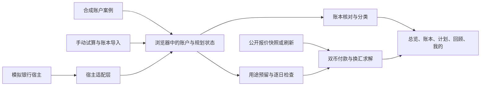

# 开发与部署指南

[项目首页](../.github/README.md) · [演示指南](DEMO.md) · [完整报告](../REPORT.md)

## 环境与启动

使用 Node.js 24。项目采用浏览器原生 JavaScript 与 Node 内置模块，没有第三方运行依赖，也不需要 npm install。

```sh
node generate.cjs
node evidence.cjs
node --test tests/*.test.cjs
node server.cjs
```

本地默认地址为 `http://127.0.0.1:4173/`。`npm run build` 生成案例和证据，`npm test` 执行测试，`npm start` 启动服务。请使用 HTTP 服务访问页面，不直接双击应用的 index.html。

## 仓库地图

运行入口保留在根目录，使现有部署、报告引用和宿主入口保持兼容。通过本页按职责查找代码。

| 范围 | 文件 / 目录 | 职责 |
| --- | --- | --- |
| 独立应用 | `index.html`, `app.js` | 页面路由、事件绑定和完整演示壳 |
| 账户与试算 | `profile.js`, `profile-ui.js` | 用户中心、演示卡号和空白试算初始化 |
| 核心账本 | `engine.js` | 整数分、流水核对、CSV 与逐日现金流 |
| 当前规划模型 | `core.js`, `core-ui.js` | 分类、用途红线、双向换汇及付款检查 |
| 交互与扩展 | `ux.js`, `ux-ui.js`, `beyond.js`, `minimal-ui.js` | 撤销、备份、重复计划、期限和回顾 |
| 八达通 | `octopus.js`, `features.js` | 独立记录导入、类型识别及核对 |
| 银行适配 | `host-adapter.js`, `shell.js`, `runtime-config.js`, `embedded-config.js` | 账户、报价、偏好及复核意图契约 |
| 宿主演示 | `host-demo.html`, `host-demo.js`, `embedded.html` | 模拟银行授权与模块嵌入 |
| 视觉样式 | `style.css`, `bank-theme.css`, `minimal.css`, `friendly.css`, `controls.css`, `profile.css` | 基础、工行色系、精简布局与响应式交互 |
| 服务与报价 | `server.cjs`, `rates.cjs`, `official-rates.json` | HTTP 白名单、健康检查和公开报价快照 |
| 合成数据 | `fixtures.js`, `generate.cjs`, `data/` | 案例源代码及可重建数据 |
| 验证 | `tests/`, `evidence.cjs`, `docs/evidence.json` | 自动测试及可重建计算证据 |
| 项目报告 | `REPORT.md`, `report.html`, `report.css`, `report-assets/` | 中文正文、阅读页及图像 |
| 报告导出 | `export-report.cjs` | 内嵌图片和样式的单文件 HTML |
| 历史与兼容 | `README.md`, `v05-notes.html`, `planner.js` | 原有说明、版本记录及旧模型回归 |

`planner.js` 保留早期模型及测试。当前页面的双向最小换汇逻辑使用 `core.js`，不要用旧模型的示例汇率替换当前公开报价。

## 数据如何流动



### 独立模式

数据由合成案例或手动输入提供。保存当前空间到浏览器 localStorage；案例之间的其他修改仅保留在会话中。CSV 和备份在浏览器解析，服务器不接收账户上传。

### 宿主模式

宿主适配层暴露 `getSnapshot`、`getRates`、`savePreferences` 与 `openFxReview`。模块检查消息来源、origin 和请求 ID；拒绝或超时不会回退合成账户。换汇复核只传递意图，不执行交易。生产对接需由银行提供真实会话、授权、字段映射、报价和复核流程。详见[接口契约](../integration-guide.html)。

## 计算约束

- 所有账户和流水金额使用整数分；人民币、港币独立核算。
- 预计收入与已到账余额分离，同日按先付款、后入账处理。
- 忽略某笔记录只改变分析口径，不撤销现金变动；充值不是消费。
- 红线取自定底线与“受保护付款 + 应急金”的较高值；生活费另进入逐日路径。
- 换汇按正确买卖方向、费用和到账日计算；报价失效或来源不可用时显示边界，不伪造实时报价。
- 钱包消费样本与银行账本中的钱包汇总不直接相加。

## 测试与验证

```sh
node --test tests/*.test.cjs
```

v0.8.0 已验证 136 项测试。测试目录按账本、规划、八达通、宿主、UX、账户初始化和服务器边界划分。修改金融逻辑时，应覆盖可独立计算的金额及边界案例；修改界面时，应检查桌面、窄屏、键盘及保存恢复。

生成可复核证据：

```sh
node evidence.cjs
```

案例及证据文件由构建命令生成；不要把本地真实账户备份混入合成 fixture。

## Render 配置

以 [render.yaml](../render.yaml) 为部署配置依据。仓库根目录即应用目录，无需填写 `poc` 子目录。

| 项目 | 值 |
| --- | --- |
| Runtime | Node.js 24 |
| Build | `node generate.cjs && node evidence.cjs && node --test tests/*.test.cjs` |
| Start | `node server.cjs` |
| Health check | `/healthz` |
| Port | Render 注入 `PORT` |
| Host | Render 使用 `0.0.0.0`；本地默认 `127.0.0.1` |
| Instance / region | Free / Singapore |

免费实例可能休眠，录屏前先访问原型。服务器仅公开允许的应用资源；源码测试、私人目录和本地验证产物不通过 HTTP 路由暴露。

发布时将互相依赖的程序和测试放在同一个提交中，再触发部署。提交前运行相关验证；发布后核对目标提交、构建结果及关键页面。只修改文档时无需反复运行未变更的计算测试。

## 离线报告

```sh
node export-report.cjs
```

输出 `artifacts/report-offline.html`，图像与 CSS 全部内嵌。也可以指定输出文件：

```sh
node export-report.cjs artifacts/competition-report.html
```

`REPORT.md` 是正文；`report.html` 是已生成的阅读页。导出脚本打包阅读页，不会自动将 Markdown 转成 HTML。正文修改后需要同步阅读页再导出。

## 维护约定

- 保留原有进度、交接和历史记录，不在整理文档时重写历史事实。
- `.github/README.md` 是仓库展示首页；本指南维护当前代码导航，`docs/DEMO.md` 维护可复现操作。
- 保持原型独立身份和数据来源说明。不要把合成卡号、模拟授权或复核意图写成已获得生产接入。
- 仓库可见性、开源许可证及真实服务权限由项目所有者决定；整理文档不会改变这些设置。
